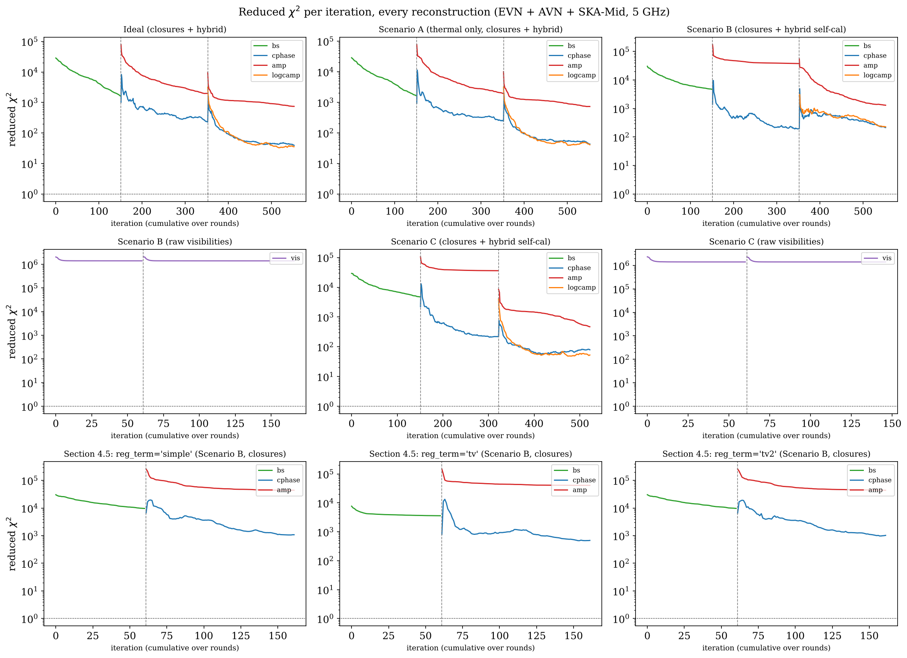
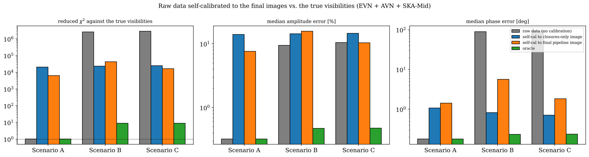
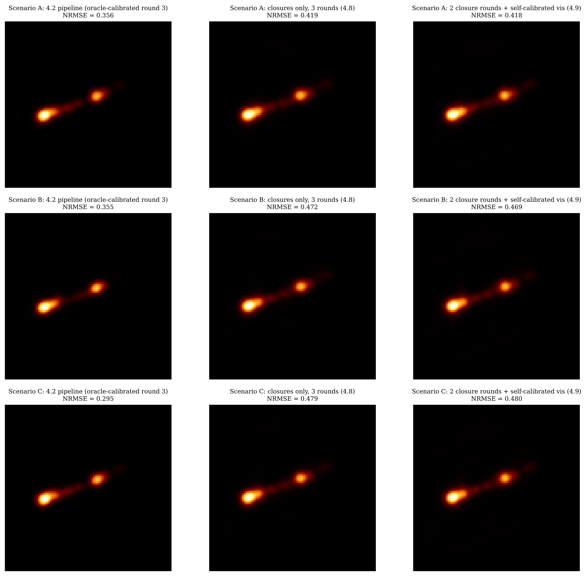
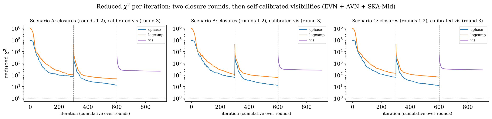

# Hands-on class: 5 GHz jet with the EVN + AVN + SKA-Mid

**Case folder:** `jet-midfreq-class/` · **Notebook:** `notebook/VLBI_ehtim_handson_ERIS2026_jet_5GHz_class.ipynb` · **Toy model:** `toy-model/jet_model.txt` · **Reference results:** `results/` · **Run time:** ~35 min

!!! important "Array: EVN + AVN + SKA-Mid (20 stations), SKA-Mid included in every simulation"
    Every simulation, calibration and image of the class uses the **EVN + AVN + SKA-Mid**: 11 EVN stations, **4 SKA-Mid elements** (`S5`, the phased-up SKA-Mid core with an SEFD of 3.1 Jy, and the dishes `S004`, `S008`, `S133`) and 5 AVN stations. The **EVN alone (no SKA)** is used only once, as a comparison, in the uv-coverage plot of Section 2.3.

This is the **teaching version** of the [5 GHz jet case](../jet-midfreq/index.md) (ERIS 2026 VLBI training session). It walks through the same physics with more explanation, more intermediate plots and controls that participants are invited to change. Compared with the delivery notebook it:

* explains every concept as it appears (uv-coverage, resolved-out flux, closure quantities, dirty and clean beams, regularizers);
* uses a simpler imaging recipe (`bs` → `amp` + `cphase` → hybrid round on self-calibrated data) and self-calibrates to the true model for illustration;
* compares the regularizers `simple`, `tv` and `tv2`;
* adds a realistic hybrid pipeline that never uses the true model: two closure rounds on the raw data, then a round on visibilities self-calibrated to the round-2 image (Section 4.9);
* ends with a proposal-oriented summary and a "bring your own source" extra section.

**How to use it in class:** run the notebook once before the session, so that the slow cells (Sections 2–4) have their outputs. During the session participants change the controls of Section 3 and re-run from there.

---

## 0. Environment setup

Installs/imports `ehtim` 1.2.10 (NumPy < 2) and explains the two Fourier engines: the simulated datasets use the exact DFT (`ttype='direct'`), because the very high SNR of the EVN + AVN + SKA-Mid baselines (the SKA-Mid core `S5` has an SEFD of only 3.1 Jy) would turn the FFT interpolation error into a systematic error; self-calibration and imaging use `ttype='fast'`. Creates the output folder and `save_fig()`.

## 1. Array configuration: EVN (no SKA) vs. EVN + AVN + SKA-Mid

Defines the two arrays as text strings (`evn_str`, `ska_str`, `avn_str`) and writes:

* `data/evn_array.txt`: the **EVN alone (no SKA)**, 11 stations;
* `data/EVN_AVN_SKAMid_array.txt`: the **EVN + AVN + SKA-Mid**, 20 stations.

The cell prints the stations of each network (EVN, **SKA-Mid**, AVN). The SKA-Mid elements are in the Karoo (South Africa); the AVN stations are Hartebeesthoek, Kuntunse (Ghana), Namibia, Botswana and Malindi (Kenya).

!!! question "Exercise"
    Remove `S5` from `ska_str` and re-run the notebook. How do the thermal noise, the dynamic range and the χ² change?

## 2. Sky model: loading the jet, and the ideal observation

* **2.1** Loads `jet_model.txt` and plots it (`01_jet_model.png`).
* **2.2** Observing parameters (5 GHz, 256 MHz, 2-min scans every 10 min, 6-h track) and the ideal observation `obs_jet_ideal`. A note explains how many visibilities to expect (at most 190 baselines × 36 scans) and why `obs.add_all()` is not called (memory).
* **2.3** uv-coverage of the **EVN alone (no SKA)** and of the **EVN + AVN + SKA-Mid**, overlaid (`02_uv_coverage_EVN_noSKA_vs_EVN_AVN_SKAMid.png`). The African stations and SKA-Mid add the north–south baselines where the EVN alone has poor coverage. The markdown explains why uniform coverage matters as much as the longest baseline.

## 3. Realistic errors and visibility corruption

* **3.1** The error types and the **controls to experiment with**:

    | Control | Default | Reasonable range |
    |---|---|---|
    | `gain_offset_val` | 0.15 | 0.0–0.3 |
    | `gainp_val` | 0.10 | 0.0–0.2 |
    | `elevation_min` | 10° | 5–20° |

    Simulates scenario B (`obs_jet_err`) and scenario A (`obs_jet_thA`).
* **3.2** Self-calibration of B **to the true model** (`cal_jet`), to illustrate that self-calibration corrects station gains without removing source structure.
* **3.3** Visibility amplitude vs. uv-distance: ideal vs. A, ideal vs. B, ideal vs. self-calibrated B (`03_amplitude_vs_uvdistance_A_B_selfcal.png`).
* **3.4** Resolved-out flux: what short and long baselines see.
* **3.5** **Scenario C**: the structured atmospheric corruptions, an ionospheric dTEC and a tropospheric delay random-walk screen (`obs_jet_errC`), its self-calibration (`cal_jet_errC`), and a numerical check that closure phases are unchanged by an antenna-based screen (`04_scenarioC_screen_and_phases.png`). This is the simple, antenna-based version of scenario C; the delivery notebook adds the in-band and in-scan decorrelation.

## 4. RML imaging: closures vs. raw visibilities

* **4.0** What a closure quantity is, and why antenna-based errors cancel in it.
* **4.1** Helper functions: `align_to_model()`, `nrmse()`, `run_rml_imager()` and **`LoggedImager`** / **`plot_chi2_histories()`**, which record and plot the χ² of every data term at every iteration (see [Imaging](../concepts/imaging.md#chi2-per-iteration)).
* **4.2** The imaging pipeline, run 6 times (ideal, A, B and C with closures + hybrid self-cal; B and C with raw visibilities), **each run recording its χ² history** in `hist_class`:

    | Round | Data terms | Regularizers | Iterations |
    |---|---|---|---|
    | 1 | `bs` | `simple`, `flux`, `cm` | 150 |
    | 2 | `amp`, `cphase` | `tv`, `flux`, `cm` | 200 |
    | 3 (self-calibrated data) | `amp`, `cphase`, `logcamp` | `tv`, `flux`, `cm` | 200 |

    Raw-visibility runs: 2 rounds on `vis` (60 + 180 iterations).
* **4.3** Visual comparison and NRMSE of ideal, A, B and C (`05_reconstructions_ideal_A_B_C.png`).
* **4.4** Dirty beam, fitted clean beam and the B image with the beam drawn (`06_dirty_beam_clean_beam.png`).
* **4.5** Regularizers `simple`, `tv` and `tv2` on scenario B (`07_regularizers_simple_tv_tv2.png`), each run also recording its χ² history (`hist_reg`).
* **4.6** Final reduced χ² of each image against its data (`cphase`, `logcamp`, `amp`).
* **4.7** **Convergence of the data fit, iteration by iteration**: all nine reconstructions (six of 4.2 and three of 4.5) in one figure, `07b_chi2_convergence_all_reconstructions.png`, with a printout of the number of iterations and final χ² of each.

* **4.8** **Self-calibration to the final images: how well do the closures work?** Makes a **closures-only image** of A, B and C (`cphase` + `logcamp`, three rounds, no calibration), self-calibrates the **raw** data to it and to the **final image of the 4.2 pipeline**, and compares the calibrated visibilities with the noise-free visibilities of the true jet (reduced χ² against the truth, median amplitude and phase errors), next to the raw data and the oracle calibration. Each calibrated dataset is then imaged with the raw-visibility recipe. Figures: `07c_selfcal_to_final_images_visibility_errors.png`, `07d_images_closures_only_and_selfcalibrated_visibilities.png` and **`07e_chi2_convergence_closures_only_and_selfcalibrated_visibilities.png`** (χ² at every iteration of the closures-only and self-calibrated-visibility reconstructions). The calibrated visibilities are saved as UVFITS. See [Self-calibration test](../concepts/imaging.md#selfcal-test).

* **4.9** **A realistic hybrid pipeline: two closure rounds, then self-calibrated visibilities.** The 4.2 pipeline uses oracle-calibrated data (self-calibrated to the true jet) in its third round, which is only possible in a simulation. Section 4.9 builds the pipeline as it is done with real data:

    | Round | Data | Data terms |
    |---|---|---|
    | 1 | raw data | `cphase` + `logcamp` (`simple` regularizer) |
    | 2 | raw data | `cphase` + `logcamp` (`tv`, re-blurred start) |
    | — | self-calibration of the raw data (amplitude and phase, per station and scan) to the round-2 image | |
    | 3 | self-calibrated visibilities | `vis` (`tv`, 300 iterations) |

    It runs for Scenarios A, B and C with the **χ² recorded at every iteration of the three rounds**, and is compared with the 4.2 pipeline and with the closures-only images of 4.8. Figures: `07f_hybrid_pipeline_closures_then_calibrated_vis.png` (the three approaches side by side, with NRMSE) and **`07g_chi2_convergence_hybrid_pipeline.png`**. The calibrated visibilities and the images are saved as UVFITS and FITS, and the comparison as `hybrid_pipeline_closures_then_calibrated_vis.csv`.

!!! question "Exercise"
    In the 4.7 figure, compare `vis` for the raw-visibility runs of B and C with the closure terms of the closure runs. Why can the first never reach χ² = 1? In 4.8, why does the oracle χ² of scenario C stay above that of B?

## 5. Analysis of results: global scientific quality

NRMSE, NXCORR, total flux, core flux and core offset, dynamic range and the χ² for every reconstruction, with three figures: metrics per scenario (`08_metrics_per_scenario.png`), a Pareto front of fidelity against data error (`09_pareto_fidelity_vs_error.png`), and closure-phase vs. visibility-phase errors (`10_closure_phase_vs_visibility_phase_errors.png`). It ends with a **discussion of the results** of the run.

## 6. From this notebook to a real observation proposal

What a Time Allocation Committee expects from a feasibility study (uv-coverage, sensitivity, imaging simulations, error budget) and how each section maps onto it, e.g. for a joint EVN + AVN + SKA-Mid session.

## 7. Export

`results_jet_5GHz_class/` and its zip: visibilities of every scenario (raw, oracle-calibrated and self-calibrated to the final images), FITS images, every figure, metric tables, `array_EVN_AVN_SKAMid.txt`, `array_EVN_alone_noSKA.txt` and a summary of the numbers to quote in a proposal.

## Extra: bring your own source

Converts a FITS image to an `ehtim` text model (`fits_to_ehtim_txt()`) and repeats the ideal → corrupted → self-cal → imaging chain on it with the **EVN + AVN + SKA-Mid**, reusing the functions above. Nothing earlier depends on it.

## Summary and references

What was done in each section, and the references (ehtim papers, EVN status table, Li et al. 2024 for the EVN, AVN and SKA-Mid positions and SEFDs).

---

## Results of the reference run

Reference run: one CPU core, **~35 min**, started with `PYTHONHASHSEED=0`. Array: **EVN + AVN + SKA-Mid** (20 stations). Your numbers will differ by a few hundredths ([why](../getting-started.md#reproducibility)).

**Data.** 6376 visibilities with the EVN + AVN + SKA-Mid, against 1860 with the **EVN alone (no SKA)** (×3.4); median SNR 183 in A. The shortest 10% of baselines see 90% of the jet flux, the longest 10% only 4% (resolved out). Fitted beam 1.96 × 0.87 mas, PA 91°.

<figure markdown>

<figcaption>uv-coverage of the EVN alone (no SKA), of the EVN + AVN + SKA-Mid, and both overlaid.</figcaption>
</figure>

| Reconstruction | NRMSE | NXCORR | flux [Jy] | dynamic range |
|---|---|---|---|---|
| Ideal (closures + hybrid) | 0.36 | 0.93 | 1.01 | 628 |
| Scenario A | 0.36 | 0.94 | 1.01 | 651 |
| Scenario B (closures + hybrid self-cal) | 0.36 | 0.94 | 1.01 | 912 |
| Scenario B (raw visibilities) | 1.53 | −0.01 | 0.05 | 15 |
| Scenario C (closures + hybrid self-cal) | 0.30 | 0.96 | 1.00 | 897 |
| Scenario C (raw visibilities) | 0.92 | 0.53 | 0.12 | 18 |
| Regularizer `simple` / `tv` / `tv2` (B) | 0.46 / 0.38 / 0.46 | 0.89 / 0.93 / 0.88 | 1.13–1.15 | 163 / 141 / 161 |

<figure markdown>

<figcaption>Ideal, A, B and C: closure-based and raw-visibility reconstructions.</figcaption>
</figure>

<figure markdown>

<figcaption>Section 4.7: reduced χ² per iteration for all nine reconstructions. The closure-based runs are still improving at the end of round 3; the raw-visibility runs flatten at ~10⁶.</figcaption>
</figure>

**Section 4.8: how well do the closures work?**

| | Phase error | Amplitude error | χ² vs. true visibilities |
|---|---|---|---|
| raw data (B, C) | ~90° | 9.5–10.5% | ~2.6–2.9 × 10⁶ |
| self-cal to the closures-only image | **0.7–1.1°** | 14–15% | ~2–2.5 × 10⁴ |
| self-cal to the final 4.2 pipeline image | 1.4–5.7° | 8–16% | 6 × 10³ – 4 × 10⁴ |
| oracle (true jet) | 0.2° | 0.5% | ~9 |

<figure markdown>

<figcaption>Raw data self-calibrated to the closures-only image and to the final pipeline image, compared with the true visibilities.</figcaption>
</figure>

<figure markdown>

<figcaption>Rows: closures-only image; image of the visibilities self-calibrated to it; image of the visibilities self-calibrated to the final pipeline image. Columns: scenarios A, B, C.</figcaption>
</figure>

<figure markdown>

<figcaption>χ² per iteration of the closures-only imaging and of the imaging of the self-calibrated visibilities.</figcaption>
</figure>

**Section 4.9: two closure rounds, then self-calibrated visibilities.**

| Scenario | 4.2 pipeline (round 3 on oracle-calibrated data) | closures only, 3 rounds (4.8) | 2 closure rounds + self-calibrated `vis` (4.9) | final χ² of `vis` (4.9) |
|---|---|---|---|---|
| A | 0.36 | 0.42 | 0.42 | 208 |
| B | 0.35 | 0.47 | 0.47 | 254 |
| C | 0.30 | 0.48 | 0.48 | 270 |

(NRMSE against the reference image; total flux of the 4.9 images 1.00 Jy.)

<figure markdown>

<figcaption>Per scenario: the 4.2 pipeline (oracle-calibrated third round), the closures-only image of 4.8, and the realistic hybrid pipeline of 4.9.</figcaption>
</figure>

<figure markdown>

<figcaption>χ² per iteration of the hybrid pipeline. Rounds 1–2 fit cphase and logcamp on the raw data; in round 3 the vis term on the self-calibrated data drops from ~5000 to ~250 within ~50 iterations and then stays flat.</figcaption>
</figure>

The realistic hybrid pipeline reaches the fidelity of the closures-only images, but not that of the 4.2 pipeline, which had calibrated its round-3 data with the true jet. After one self-calibration to the round-2 image, the data agree with that image, errors included, so the third round has nothing new to fit. Iterating self-calibration and imaging (phase first, amplitudes later) is what closes the gap.

**Take-home messages for the class.**

* Closure quantities make B and C as good as A; raw visibilities fail completely.
* The closures alone determine the **phases** very well (≈1° after self-calibration to the closures-only image); the **amplitudes** need the calibrated-amplitude rounds of hybrid mapping.
* One self-calibration step cannot add information the model does not have (Sections 4.8 and 4.9): iterate, phase first, then amplitudes.
* The χ² histories show when a run stopped too early: compare images (and regularizers) only once their χ² has flattened.

## Troubleshooting

| Symptom | Cause and fix |
|---|---|
| `jet_model.txt` not found (point-source fallback used) | Run the notebook from `notebook/` (it reads `../toy-model/jet_model.txt`) or copy the model next to it (Colab: upload it). |
| A figure appears at the end of every imaging round | Make sure `run_rml_imager` is the notebook's version (it wraps `make_image_I` with `plt.ioff()`). |
| The class runs out of time | Run the notebook before the session; participants only re-run Sections 3–5 after changing the controls. |
| Numbers differ from those in the guide | Expected for B and C: `ehtim` gain seeds depend on the Python hash seed. |
