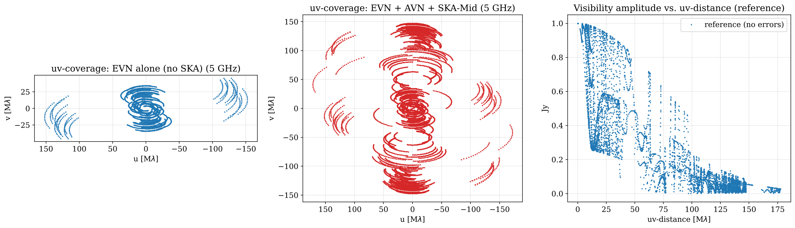
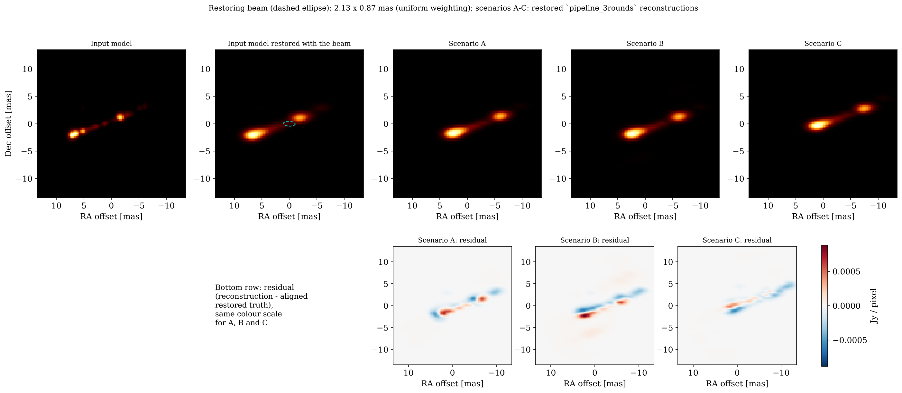
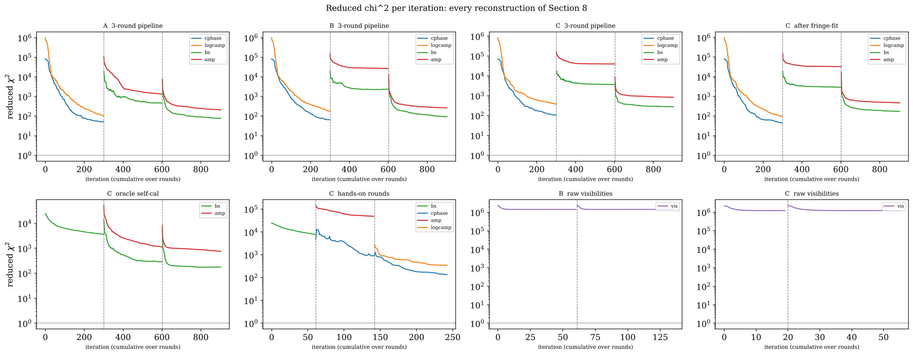
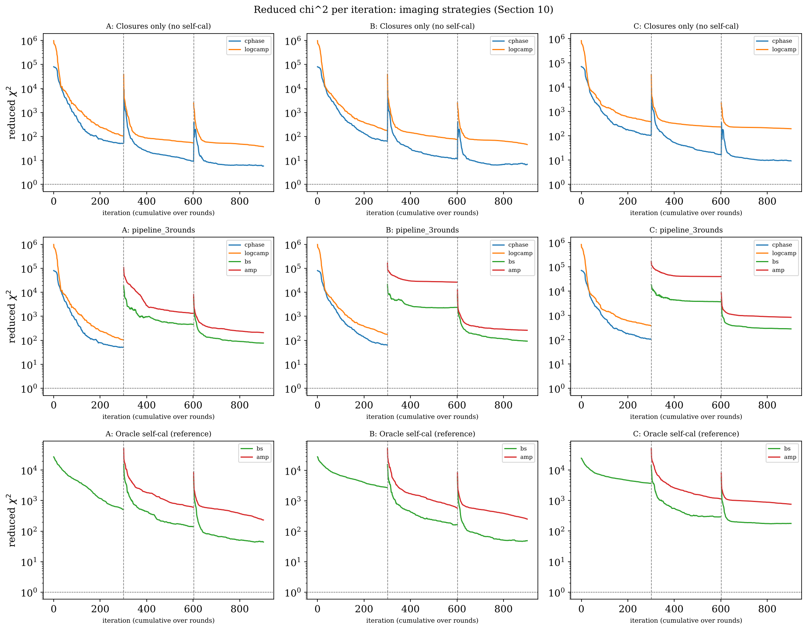
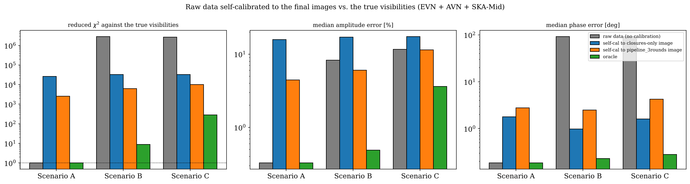
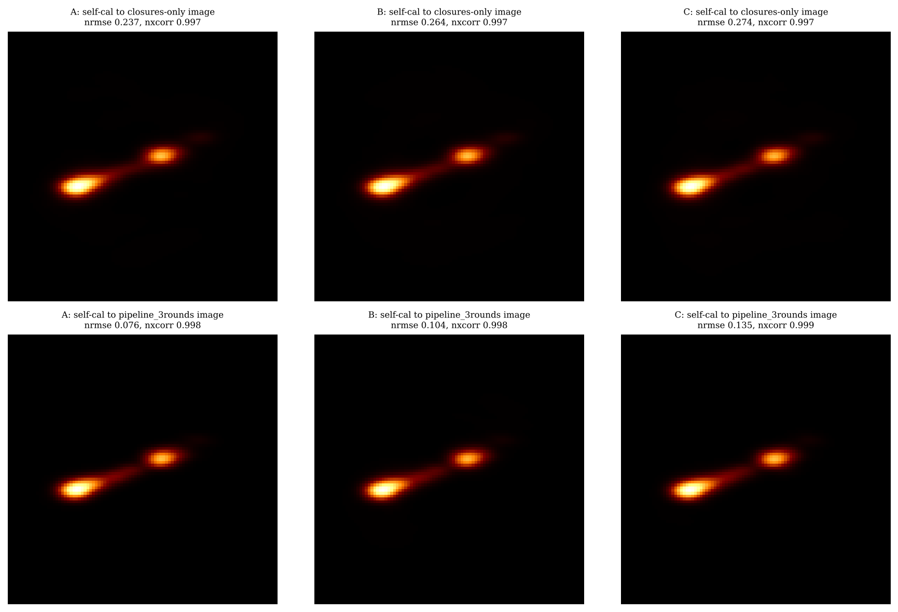
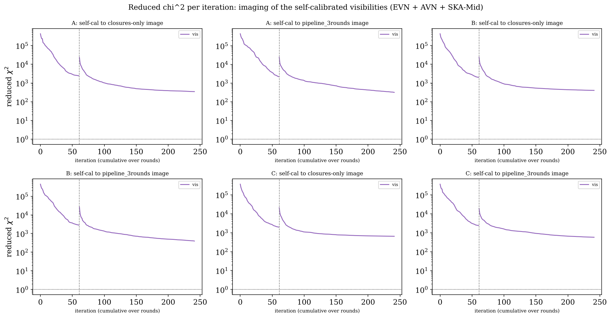

# EVN + AVN + SKA-Mid at 5 GHz: relativistic jet

**Case folder:** `jet-midfreq/` · **Notebook:** `notebook/VLBI_ehtim_EVN_AVN_SKAMid_5GHz_jet_ABC.ipynb` · **Toy model:** `toy-model/jet_model.txt` · **Reference results:** `results/` · **Run time:** ~50 min

!!! important "Array: EVN + AVN + SKA-Mid (20 stations), SKA-Mid included in every simulation"
    11 EVN stations, **4 SKA-Mid elements** (`S5`, the phased-up SKA-Mid core, and the dishes `S004`, `S008`, `S133`) and 5 AVN stations. The **EVN alone (no SKA)** is simulated once, only for the uv-coverage comparison of Section 3. See [Arrays](../concepts/arrays.md).

This notebook tests the self-calibration + closure-quantity imaging pipeline on a **resolved, asymmetric source**, a simulated relativistic jet, observed at 5 GHz (C-band) with the EVN + AVN + SKA-Mid, under scenarios A, B and C. It is the hardest of the static cases: the jet has non-zero closure phases, a core and knots spread over ~15 mas, and a dynamic range of several hundred. Its companion is the [hands-on class notebook](../jet-midfreq-class/index.md) on the same source; the [Gaussian notebook](../point-source-midfreq/index.md) uses the same array with a compact source.

## Quick start

1. Run from `notebook/`: the notebook finds `../toy-model/jet_model.txt` by itself (in Colab, upload `jet_model.txt` to the session files).
2. Run all cells. The notebook stops with an explicit error if the model file is missing.
3. Open `notebook/results_VLBI_5GHz_jet/` (or the zip file) for the UVFITS files, figures, FITS images and tables. The reference run is in the case's `results/` folder.

The parameters you are most likely to change are all in the cells of Sections 1, 6 and 8 and are listed in the tables below.

---

## 0. Setup

Imports `ehtim` and checks the environment. `ehtim` 1.2.10 needs **NumPy < 2**: if the cell installs `ehtim` in Colab, restart the session once and run again. It also defines `save_fig()` (every figure is written to `results_VLBI_5GHz_jet/figures/`), the unit `mas` in radians and a `silent()` context that hides `ehtim`'s progress messages.

## 1. Array, sensitivities (SEFD) and observing parameters

Builds two array files and loads them:

* `data/evn_avn_array.txt`: the **EVN + AVN + SKA-Mid**, used for every simulation;
* `data/evn_array.txt`: the **EVN alone (no SKA)**, used only for the uv-coverage figure.

It prints every station with its network (EVN, **SKA-Mid** or AVN) and SEFD, and writes `tables/sefd_5GHz.csv`.

| Parameter | Default | Meaning |
|---|---|---|
| `nu`, `bw`, `n_chan` | 5 GHz, 256 MHz, 32 | frequency, bandwidth, channels used for the in-band decorrelation of scenario C |
| `tint`, `tadv` | 120 s, 600 s | scan length and scan spacing (2-min scans every 10 min) |
| `obs_hours` | 6 | length of the observing window; the window itself is chosen in Section 3 |
| `elevation_min` | 10° | minimum elevation for all stations |
| `gain_offset_val`, `gainp_val` | 0.15, 0.10 | gain-error budget of scenarios B and C |
| `beam_weighting` | `'uniform'` | weighting of the fitted dirty beam that restores the final images |

!!! note "Assumed sensitivities"
    The EVN SEFDs are typical published C-band values. The SEFDs of the **SKA-Mid elements** (3.1 Jy for the phased core `S5`, 330 Jy per dish) and of the AVN dishes are assumptions for a future VLBI-capable network. All thermal-noise levels follow from them.

## 2. Jet source model

Loads `jet_model.txt` (an `ehtim` text image: 64 × 64 pixels over 18 mas, 281 µas pixels, normalised to 1 Jy) with a bright core, a chain of knots and a second bright knot ~9 mas downstream. Its flux centroid is ~3 mas from the image centre, which is why the reconstruction grid of Section 8 is 1.5 times larger than the model grid.

**Output:** `01_input_model.png`.

## 3. Reference observation (no errors) and uv-coverage

* **Observing window.** Counts visibilities per hour over a day and picks the 6-h window (UTC) with most data.
* **Reference observation.** Error-free (`add_th_noise=False`), computed with the exact DFT (`ttype='direct'`): with a median SNR of several hundred, the FFT interpolation error would be larger than the thermal noise.
* **uv-coverage** of the **EVN alone (no SKA)** and of the **EVN + AVN + SKA-Mid**, and the reference visibility amplitudes against uv-distance.
* **Baselines and closure triangles with signal**: the number of baselines with median SNR > 5 and of triangles with all three legs above that threshold.

**Output:** `02_uvcoverage_and_reference_amplitudes.png`.

!!! tip "Memory: no `add_all()`"
    With 20 stations there are 1140 closure triangles per scan; pre-computing every closure table with `obs.add_all()` takes more than 1 GB per dataset and exhausts a Colab session. The notebook only calls `obs.add_scans()` (needed by `self_cal(..., scan_solutions=True)`); the imager builds the closure quantities it needs.

## 4. Scenario A: thermal noise only

`obs_A`: the reference observation with thermal noise, perfectly calibrated.

## 5. Scenario B: thermal noise + gain errors + generic phase errors

`obs_B`: `ampcal=False` with `gain_offset`, `gainp`, and `phasecal=False` (random per-station phases). See [Scenarios](../concepts/scenarios.md#scenario-b-gains-and-random-phases).

## 6. Scenario C: thermal noise + gain errors + structured atmospheric phase errors (ionosphere + troposphere)

Builds the per-station dTEC and delay screen (`make_screens`) and applies it with in-band and in-scan averaging (`apply_iono`); the thermal noise is added after the screen. The screen parameters are those of the 250 MHz LBA + SKA-Low notebook, so the two notebooks isolate the effect of frequency.

| Parameter | Default | Meaning |
|---|---|---|
| `dtec0_sigma` | 0.3 TECU | static per-station dTEC offset |
| `dtec_rate` | 0.02 TECU/√min | dTEC random-walk rate |
| `tau0_sigma_ns` | 0.5 ns | static per-station delay |
| `tau_rate_ns` | 0.01 ns/√min | delay random-walk rate |

At 5 GHz, 1 TECU is only 1.7 rad, so the in-band decorrelation is dominated by the **delay** (tropospheric) term. The cell also builds:

* `obs_Cff`: scenario C after an **idealised fringe fit** (scan-average delay/dTEC and their linear drift removed per baseline), imaged once in Section 8 as an extra reference;
* the decorrelation with the delay term only and with the dTEC term only, to show which one matters.

**Output:** `03_diagnostics_screen_and_visibilities.png` (screen, raw and oracle-calibrated amplitudes, closure phases).

## 7. Self-calibration (oracle reference) and closure check

* Self-calibrates B and C to the **true** model (oracle, a best-case reference; the pipeline of Section 8 never does this).
* Compares the closure phases of each scenario with those of the reference, triangle by triangle: in A and B the residual is thermal noise only (antenna-based errors cancel), in C the decorrelation adds scatter.
* Checks that a pure phase screen (no decorrelation, no noise) leaves the closure phases unchanged.
* Reports the reduced χ² of the oracle-calibrated data against the true model.

**Output:** `04_closure_phase_residuals_and_decorrelation.png`.

## 8. Imaging: closure quantities vs. raw visibilities

Runs **8 reconstructions** with the [3-round pipeline](../concepts/imaging.md#pipeline_3rounds-closures-first-then-self-calibration) and the references: A, B, C and C after the idealised fringe fit with `pipeline_3rounds`; C with the oracle pipeline; the hands-on closure rounds on oracle-calibrated C; raw visibilities of B and C. **Every reconstruction records its χ² history** (`hist` dictionary).

| Parameter | Default | Why |
|---|---|---|
| `npix_rec`, `fov_factor` | 96, 1.5 | 96 pixels over 1.5 × the model FOV (27 mas), so a shifted reconstruction still fits |
| `prior_fwhm` | 0.6 × model FOV (~11 mas) | a one-beam prior is too small for a closure-only round to grow a 15 mas jet |
| `w_simple`, `w_tv` | 10, 1 | weaker than for a compact source; stronger values over-smooth the knots |
| `w_flux` | 1e5 | closures do not constrain the total flux; with 1000 it ran away to ~3.5 Jy |
| `w_flux_cl` | 1e7 | flux weight in the closure-only rounds (costs nothing in the fit) |
| `maxit_rounds` | (300, 300, 300) | an extended source needs many more iterations than a compact one |
| `selfcal_round2` | `'phase'` | amplitude self-cal to an incomplete round-1 image transferred its errors (images ~25% too bright) |

**Final restoring beam:** the fitted dirty beam (`obs.fit_beam`), printed by the cell.

## 9. Metrics and diagnostics

* **Metrics table** for every reconstruction: compact (core) flux / true, core offset relative to the flux centroid, dynamic range, total flux, `nrmse`, `nxcorr` ([definitions](../concepts/imaging.md#metrics)).
* **Images**: every reconstruction (`05_reconstructions_all.png`) and A, B, C next to the restored truth with their residuals (`06_scenarios_A_B_C_vs_truth.png`).
* **Convergence of the pipeline** for A, B and C (`07_chi2_convergence.png`).
* **Convergence of every reconstruction**: one panel per reconstruction of Section 8, every data term at every iteration (`07b_chi2_convergence_all_reconstructions.png`). See [how to read the χ² figures](../concepts/imaging.md#chi2-per-iteration).

## 10. Comparison of imaging strategies

Closures only, `pipeline_3rounds` and the oracle pipeline on A, B and C (the Section 8 images are reused where possible; 5 new reconstructions). Outputs: the NRMSE/NXCORR table, `08_imaging_strategies_comparison.png`, `09_fidelity_summary.png` and the **χ² history of every strategy and scenario**, `09b_chi2_convergence_imaging_strategies.png`.

## 11. Self-calibration to the final images: how well do the closures work?

**The added case.** For each scenario the **raw** data are self-calibrated (amplitude + phase, one gain per station and scan) to two models: the **closures-only image** of Section 10 (a direct test of the closure quantities) and the **final image of `pipeline_3rounds`** (the last image generated). Each model is first moved, sub-pixel, to the true position (closures do not fix the absolute position, and a shift is an antenna-based phase gradient). The calibrated visibilities are then compared with the **noise-free visibilities of the true source**, and imaged once more with the raw-visibility recipe (`vis_rounds`), recording the χ² at every iteration. See [Self-calibration test](../concepts/imaging.md#selfcal-test).

| Output | Content |
|---|---|
| table (printed and `selfcal_to_final_images_visibility_errors.csv`) | per scenario: raw data, self-cal to the closures-only image, self-cal to the pipeline image, oracle; model shift, **reduced χ² against the true visibilities**, median amplitude error [%], median phase error [deg] (SNR > 5) |
| `10_selfcal_to_final_images_visibility_errors.png` | the three error measures as bar charts, per scenario |
| `10b_images_of_selfcalibrated_visibilities.png` | the 6 images made from the self-calibrated visibilities, with NRMSE and NXCORR |
| `10c_chi2_convergence_selfcalibrated_visibilities.png` | **χ² at every iteration** of those 6 reconstructions |
| `visibilities/scenario{A,B,C}_selfcal_to_{closures,pipeline}_image.uvfits` | the calibrated visibilities |

**How to read it.** If the χ² against the truth and the phase/amplitude errors after self-calibration to the closures-only image are close to those of the oracle, the closure quantities alone captured the source well enough to calibrate the data. The gap between the two models shows what the later rounds of the pipeline add. In scenario C, no antenna-based calibration (not even the oracle) can remove the in-band decorrelation, so the oracle χ² is itself above 1.

## 12. Discussion of the results

A discussion of the numbers of this run: the effect of each scenario, what the χ² histories show, and the comparison of strategies. The reference run is summarised [below](#results-of-the-reference-run).

## 13. Export

Writes `results_VLBI_5GHz_jet/` and `results_VLBI_5GHz_jet.zip`:

| Folder | Content |
|---|---|
| `visibilities/` | reference, A, B, C, C after fringe fit, oracle-calibrated B and C, and A, B, C self-calibrated to the closures-only and pipeline images (`.uvfits`, `.txt`) |
| `figures/` | all figures, including `07b_*`, `09b_*` and `10c_*` (χ² per iteration) |
| `images/` | input model, restored input model, all reconstructions (`.fits`) |
| `tables/` | `metrics_reconstructions.csv`, `metrics_imaging_strategies.csv`, `chi2_final_per_round.csv`, `selfcal_to_final_images_*.csv`, `pipelines_regularizers.csv/.md`, `sefd_5GHz.csv`, `screen_scenarioC.npz`, `array_EVN_AVN_SKAMid.txt`, `array_EVN_alone_noSKA.txt`, `README.txt` |

## 14. Conclusions and limitations

Summarises what the experiment measures and its assumptions (assumed SKA-Mid and AVN SEFDs, illustrative screen, no fringe-fit step in the pipeline, a single elevation limit).

---

## Results of the reference run

Reference run: one CPU core, **~50 min**. Array: **EVN + AVN + SKA-Mid** (20 stations). The numbers of B and C change slightly from run to run ([why](../getting-started.md#reproducibility)).

**Data.** 6498 visibilities on 190 baselines (1800 with the **EVN alone (no SKA)**); all 1140 closure triangles with SNR > 5; median SNR ~180. Restoring beam 2.13 × 0.87 mas, PA 87°. The shortest 10% of the baselines see 88% of the flux, the longest 10% only 3%.

<figure markdown>

<figcaption>uv-coverage of the EVN alone (no SKA) and of the EVN + AVN + SKA-Mid, and reference amplitudes of the jet.</figcaption>
</figure>

| Reconstruction | nrmse | nxcorr | flux [Jy] | dynamic range |
|---|---|---|---|---|
| A, `pipeline_3rounds` | 0.09 | 1.00 | 1.00 | ~2800 |
| B, `pipeline_3rounds` | 0.12 | 0.99 | 1.03 | ~1300 |
| C, `pipeline_3rounds` | 0.08 | 1.00 | 0.96 | ~2700 |
| C after idealised fringe fit | 0.09 | 1.00 | 1.05 | ~1800 |
| C, oracle pipeline | 0.11 | 0.99 | 1.01 | ~2400 |
| B / C raw visibilities | 18 / 88 | 0.50 / 0.71 | 0.08 / 0.01 | 39 / 162 |

| Strategy (Section 10), nrmse | A | B | C |
|---|---|---|---|
| Closures only | 0.24 | 0.27 | 0.27 |
| `pipeline_3rounds` | **0.09** | **0.12** | **0.08** |
| Oracle self-cal | 0.07 | 0.10 | 0.11 |

<figure markdown>

<figcaption>Scenarios A, B and C with the pipeline, the restored truth and the residuals.</figcaption>
</figure>

<figure markdown>

<figcaption>Reduced χ² of every data term at every iteration, for every reconstruction of Section 8. In B and C the amplitude χ² of round 2 stays high (phase-only self-calibration) and drops by 50–100× after the amplitude self-calibration before round 3.</figcaption>
</figure>

<figure markdown>

<figcaption>χ² per iteration of the imaging strategies of Section 10.</figcaption>
</figure>

**Self-calibration to the final images (Section 11).**

| Scenario | Visibilities | χ² vs. true | Amplitude error | Phase error |
|---|---|---|---|---|
| B | raw | 2.8 × 10⁶ | 8.3 % | 91° |
| B | self-cal to closures-only image | 3.3 × 10⁴ | 17 % | **1.0°** |
| B | self-cal to pipeline image | 6.1 × 10³ | **6.0 %** | 2.5° |
| B | oracle | 8.8 | 0.5 % | 0.23° |
| C | self-cal to closures-only image | 3.3 × 10⁴ | 17 % | 1.6° |
| C | self-cal to pipeline image | 1.0 × 10⁴ | 11 % | 4.2° |
| C | oracle | 283 | 3.6 % | 0.28° |

<figure markdown>

<figcaption>Raw data self-calibrated to the closures-only image (blue) and to the pipeline image (orange), compared with the true visibilities.</figcaption>
</figure>

<figure markdown>

<figcaption>Images of the self-calibrated visibilities: nrmse 0.24–0.27 for the closures-only model, 0.08–0.14 for the pipeline model.</figcaption>
</figure>

<figure markdown>

<figcaption>χ² per iteration of the imaging of the self-calibrated visibilities.</figcaption>
</figure>

**Main conclusions.**

* All three scenarios recover the core–jet structure (nxcorr ≥ 0.99); for this source B and C cost little once closures and iterative self-calibration are used.
* For an extended source, the self-calibration steps are essential: closures alone stop at nrmse ~0.25.
* **The closures alone determine the phases best** (1.0–1.8° after self-calibration to the closures-only image, from 91°), but **not the flux distribution** (16–17% amplitude errors). Calibrate the phases first and the amplitudes later, as the pipeline does.

## Troubleshooting

| Symptom | Cause and fix |
|---|---|
| `FileNotFoundError: jet_model.txt` | Run the notebook from `notebook/` (it reads `../toy-model/jet_model.txt`) or copy the model next to it (Colab: upload it to the session files). |
| `ImportError` / `numpy.core.multiarray failed to import` | NumPy ≥ 2 is installed: `pip install "numpy<2"` and restart the kernel. |
| The kernel dies during Section 3 or 7 | Out of memory: do not add `obs.add_all()`; close other notebooks. |
| Total flux of the reconstructions far from 1 Jy | `w_flux` / `w_flux_cl` too small for this SNR. |
| χ² still falling at the end of a round | Increase the corresponding entry of `maxit_rounds`. |
| Numbers of B and C differ from the guide | Expected: `ehtim` gain seeds depend on the Python hash seed. Use `PYTHONHASHSEED=0`. |
