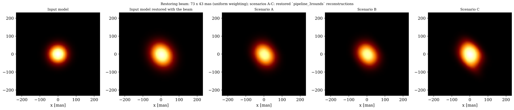
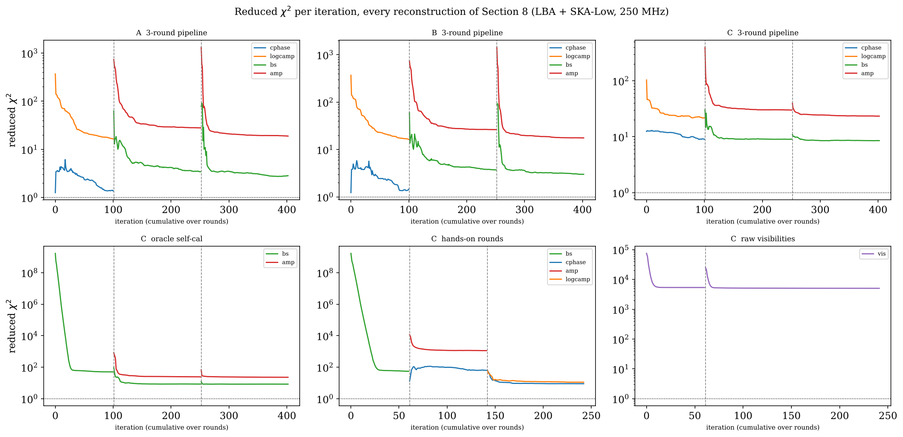
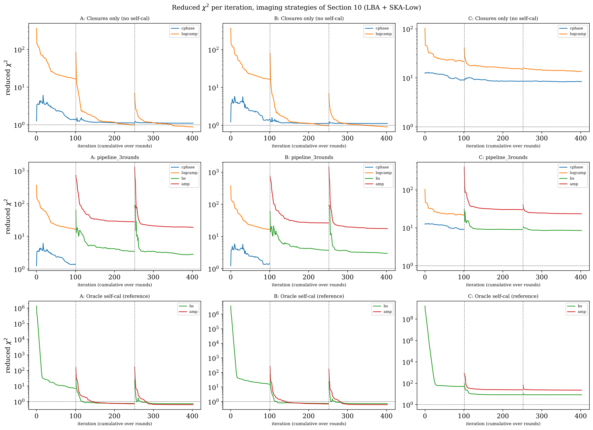
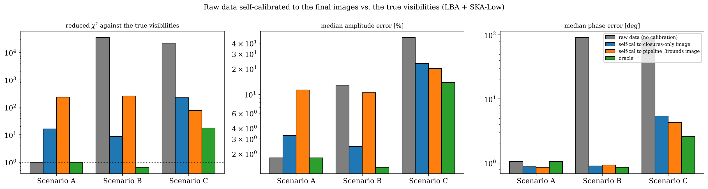
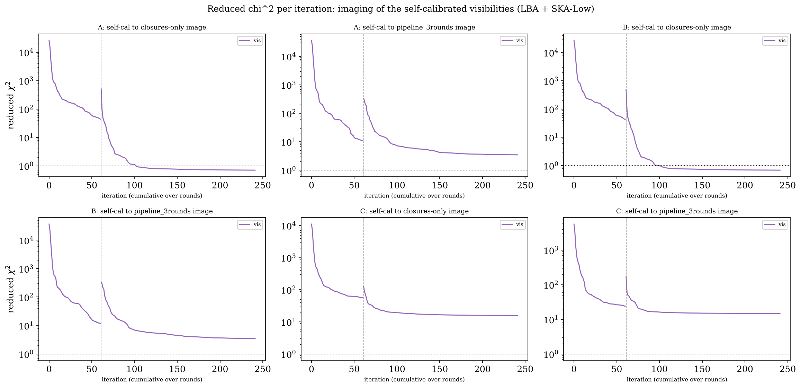

# LBA + SKA-Low at 250 MHz: Gaussian source

**Case folder:** `point-source-lowfreq/` · **Notebook:** `notebook/VLBI_ehtim_LBA6_SKALow_250MHz_ABC.ipynb` · **Toy model:** `toy-model/` (built by the notebook; FITS and text copies) · **Reference results:** `results/` · **Run time:** ~10 min

!!! important "Array: LBA + SKA-Low (7 stations), SKA-Low included in every simulation"
    Six Long Baseline Array antennas (Parkes, ATCA, Hobart, Ceduna, Warkworth, Katherine) **plus SKA-Low**, phased as a single VLBI station. There is no LBA-only run: SKA-Low takes part in every observation, calibration and image, and it is by far the most sensitive element (4.4 Jy against ~2000 Jy for the LBA antennas). See [Arrays](../concepts/arrays.md#lba-skalow).

This is the reference notebook of the project: the first to be completed, and the one whose format the other notebooks follow. It simulates a low-frequency VLBI observation of a southern **circular Gaussian** (80 mas FWHM, 1 Jy, RA 5 h, Dec −35°) at 250 MHz, where the **ionosphere** is the dominant source of phase errors, and tests the 3-round imaging pipeline under scenarios A, B and C.

!!! warning "A hypothetical configuration"
    The LBA has no receivers at 250 MHz (its lowest band is ~700 MHz at Parkes and 1.3–1.4 GHz elsewhere). Station positions and apertures are real; the sensitivities are assumptions (Section 1).

---

## 0. Setup

Imports, `save_fig()` (figures go to `results_VLBI/figures/`) and the output folders. Needs `ehtim` 1.2.10 with NumPy < 2.

## 1. Array (LBA + SKA-Low), sensitivities (SEFD) and observing parameters

Builds the station list from geodetic coordinates, computes the SEFDs and writes `data/array_LBA6_SKALow.txt`. The cell prints, per station, the published 1.3 GHz SEFD, a naive extrapolation to 250 MHz and **the SEFD actually used**, and finally the composition of the array (`LBA + SKA-Low: 7 stations = 6 LBA + SKA-Low`).

| Parameter | Default | Meaning |
|---|---|---|
| `nu`, `bw`, `n_chan` | 250 MHz, 50 MHz, 32 | frequency, bandwidth, channels for the in-band decorrelation |
| `tint`, `tadv` | 120 s, 300 s | 2-min scans every 5 min |
| `obs_hours` | 8 | length of the observing window (chosen in Section 2) |
| `elevation_min` | 10° | minimum elevation |
| `gain_offset_val`, `gainp_val` | 0.15, 0.10 | gain-error budget of B and C |
| `flux_jy`, `src_fwhm_mas` | 1.0 Jy, 80 mas | source flux and size |
| `src_ra_h`, `src_dec_deg` | 5 h, −35° | source position |
| `npix_rec`, `fov_beams` | 64, 10 | reconstruction grid (pixels, FOV in nominal beams) |
| `sefd_lba_250` | 2000 Jy each | LBA SEFDs at 250 MHz (one editable entry per station) |
| `ska_n_elem`, `ska_n_tied` | 256, 512 | SKA-Low dipoles per station, stations phased together |
| `T_rx`, `T_other` | 30 K, 5 K | receiver and other contributions to Tsys |

**SKA-Low SEFD.** SEFD = 2 kB Tsys / Aeff with Aeff = 256 λ²/3 per station and Tsys = Trx + Tother + Tsky(ν), Tsky = 237 K (ν/150 MHz)−2.52: ~2260 Jy per station, **4.4 Jy** for 512 tied stations. Lower `ska_n_tied` to model a sub-array (a single station gives ~2200 Jy).

## 2. Gaussian source model and observing window

Builds the 80 mas Gaussian (about 1.5 times the nominal 50 mas resolution of the LBA + SKA-Low, so it is clearly resolved: its amplitude falls to ~0.9 of the total flux at 500 km, 0.4 at 1500 km and ~0.04 at 3000 km), and `rows_per_hour()` picks the best 8-h window.

**Output:** `01_input_model.png`.

!!! tip "Changing the source size"
    A larger source loses the signal on the long baselines and, with it, the closure triangles. Section 3 counts them for the chosen size.

## 3. Reference observation (no errors)

The error-free reference observation (`obs_ideal`), plus a count of the baselines with median SNR > 5 and of the closure triangles with all three legs above it.

## 4. Scenario A: thermal noise only

`obs_A`.

## 5. Scenario B: thermal noise + gain errors + generic phase errors

`obs_B`.

## 6. Scenario C: thermal noise + gain errors + structured ionospheric / delay phase error

The dTEC and delay screen (`make_screens`) and its in-band and in-scan averaging (`apply_iono`); see [Scenarios](../concepts/scenarios.md#scenario-c-a-physical-ionospheric-and-delay-screen).

| Parameter | Default | Meaning |
|---|---|---|
| `dtec0_sigma` | 0.3 TECU | static per-station dTEC |
| `dtec_rate` | 0.02 TECU/√min | dTEC random-walk rate |
| `tau0_sigma_ns`, `tau_rate_ns` | 0.5 ns, 0.01 ns/√min | delay offset and random walk |
| `n_sub` | 24 | sub-integrations per scan for the in-scan average |

At 250 MHz, 1 TECU is **33.8 rad**: the ionospheric phase changes by several radians across the 50 MHz band, so the decorrelation is large, ionospheric and not antenna-based.

## 7. Self-calibration (oracle reference) and closure check

Oracle self-calibration of B and C to the true model (reference only), the closure-phase RMS of each scenario (the true closure phases of a centred Gaussian are zero) and the check that a pure phase screen leaves closure phases unchanged.

## 8. Imaging: closure quantities vs. raw visibilities

Six reconstructions, **each with its χ² history** (`hist`): `pipeline_3rounds` on A, B and C; the oracle pipeline on C; the hands-on closure rounds on oracle-calibrated C; raw visibilities of C.

| Parameter | Default | Meaning |
|---|---|---|
| `w_simple`, `w_tv` | 100, 10 | entropy and TV weights (×10 w.r.t. a coarse 26 mas grid) |
| `FM` | `flux` 1000, `cm` 50 | total-flux and centre-of-mass constraints |
| rounds | 100 / 150 / 150 iterations | `pipeline_3rounds`: closures → self-cal + `bs`/`amp` → self-cal + `tv` |
| prior | one nominal beam | source-agnostic Gaussian prior |
| restoring beam | fitted dirty beam, `beam_weighting` | printed by the cell |

## 9. Metrics and diagnostics

* Metrics table: aperture flux (1.5 beams) / true, peak offset, dynamic range, `nrmse`, `nxcorr`.
* `02_diagnostics_dTEC_visibilities_closure.png`: the simulated dTEC, raw and oracle-calibrated amplitudes, closure-phase histograms.
* `03_reconstructions_all.png` and `04_scenarios_A_B_C_vs_truth.png`.
* `05_chi2_convergence.png`: convergence of `pipeline_3rounds` for A, B, C.
* **`05b_chi2_convergence_all_reconstructions.png`: the χ² of every data term at every iteration for all six reconstructions** (see [how to read it](../concepts/imaging.md#chi2-per-iteration)).

## 10. Comparison of imaging strategies

Closures only, `pipeline_3rounds` and the oracle pipeline on A, B and C (9 runs, each with its χ² history), `06_imaging_strategies_comparison.png` and **`06b_chi2_convergence_imaging_strategies.png`**.

## 11. Self-calibration to the final images: how well do the closures work?

**The added case.** For each scenario the **raw** data are self-calibrated (amplitude + phase, one gain per station and scan) to two models: the **closures-only image** of Section 10 (a direct test of the closure quantities) and the **final image of `pipeline_3rounds`** (the last image generated). Each model is first moved, sub-pixel, to the true position (closures do not fix the absolute position, and a shift is an antenna-based phase gradient). The calibrated visibilities are then compared with the **noise-free visibilities of the true source**, and imaged once more with the raw-visibility recipe (`vis_rounds`), recording the χ² at every iteration. See [Self-calibration test](../concepts/imaging.md#selfcal-test).

| Output | Content |
|---|---|
| table (printed and `selfcal_to_final_images_visibility_errors.csv`) | per scenario: raw data, self-cal to the closures-only image, self-cal to the pipeline image, oracle; model shift, **reduced χ² against the true visibilities**, median amplitude error [%], median phase error [deg] (SNR > 5) |
| `07_selfcal_to_final_images_visibility_errors.png` | the three error measures as bar charts, per scenario |
| `07b_images_of_selfcalibrated_visibilities.png` | the 6 images made from the self-calibrated visibilities, with NRMSE and NXCORR |
| `07c_chi2_convergence_selfcalibrated_visibilities.png` | **χ² at every iteration** of those 6 reconstructions |
| `visibilities/scenario{A,B,C}_selfcal_to_{closures,pipeline}_image.uvfits` | the calibrated visibilities |

**How to read it.** If the χ² against the truth and the phase/amplitude errors after self-calibration to the closures-only image are close to those of the oracle, the closure quantities alone captured the source well enough to calibrate the data. The gap between the two models shows what the later rounds of the pipeline add. In scenario C, no antenna-based calibration (not even the oracle) can remove the in-band decorrelation, so the oracle χ² is itself above 1.

## 12. Discussion of the results

A discussion of the numbers of the run (see [below](#results-of-the-reference-run)).

## 13. Export everything to a single folder

`results_VLBI/` and `results_VLBI.zip`:

| Folder | Content |
|---|---|
| `visibilities/` | reference, A, B, C, the oracle-calibrated B and C, and A, B, C self-calibrated to the closures-only and pipeline images (`.uvfits`, `.txt`) |
| `figures/` | all figures, including the χ² figures `05`, `05b`, `06b`, `07c` |
| `images/` | input model, restored model, all reconstructions and strategy images (`.fits`) |
| `tables/` | `metrics_reconstructions.csv`, `metrics_imaging_strategies.csv`, **`chi2_history_all_reconstructions.csv`**, **`chi2_final_per_round.csv`**, `selfcal_to_final_images_*.csv`, `pipelines_regularizers.csv/.md`, `sefd_250MHz.csv`, `dtec_screen_scenarioC.npz`, `array_LBA6_SKALow.txt`, `README.txt` |

## 14. Conclusions and limitations

What the experiment measures and its limitations: a forgiving source model, assumed sensitivities, an illustrative screen, a single elevation limit, and no Faraday rotation, scattering or dispersive fringe fit.

---

## Results of the reference run

Reference run: one CPU core, **10 min**. Array: **LBA + SKA-Low**. The numbers of B and C change slightly from run to run ([why](../getting-started.md#reproducibility)).

**Data.** 1850 visibilities on 21 baselines; 17 baselines and 19 of 35 closure triangles with SNR > 5 (median SNR 27 in A). Restoring beam 73 × 43 mas, PA 32°. Scenario C: mean decorrelation |Γ| = 0.47 (minimum 0.02).

| Reconstruction | nrmse | nxcorr | dynamic range | final χ² (round 3) |
|---|---|---|---|---|
| A, `pipeline_3rounds` | 0.20 | 1.00 | 1826 | bs 2.8, amp 18.9 |
| B, `pipeline_3rounds` | 0.21 | 1.00 | 1833 | bs 3.0, amp 17.6 |
| C, `pipeline_3rounds` | 0.12 | 0.99 | 831 | bs 8.5, amp 23.4 |
| C, oracle self-cal | 0.11 | 0.99 | 146 | bs 8.4, amp 22.8 |
| C, raw visibilities | 2.62 | 0.85 | 11 | vis 5048 |

| Strategy (Section 10), nrmse | A | B | C |
|---|---|---|---|
| Closures only | **0.04** | **0.05** | 0.15 |
| `pipeline_3rounds` | 0.20 | 0.21 | **0.12** |
| Oracle self-cal | 0.02 | 0.03 | 0.11 |

<figure markdown>

<figcaption>Restored reconstructions of A, B and C with the LBA + SKA-Low, next to the true model restored with the same beam.</figcaption>
</figure>

<figure markdown>

<figcaption>Reduced χ² of every data term at every iteration, for every reconstruction of Section 8. Round 1 stops with logcamp χ² ≈ 16 (not converged); in C every term stays well above 1, as for the oracle.</figcaption>
</figure>

<figure markdown>

<figcaption>χ² per iteration of the imaging strategies. The closures-only runs bring the log closure amplitudes from 16 to below 1 in A and B.</figcaption>
</figure>

**Self-calibration to the final images (Section 11).**

| Scenario | Visibilities | χ² vs. true | Amplitude error | Phase error |
|---|---|---|---|---|
| B | raw | 34 000 | 12.6 % | 90° |
| B | self-cal to closures-only image | **8.7** | **2.4 %** | **0.9°** |
| B | self-cal to pipeline image | 257 | 10.5 % | 0.9° |
| B | oracle | 0.65 | 1.4 % | 0.9° |
| C | raw | 22 000 | 46 % | 89° |
| C | self-cal to closures-only image | 224 | 23 % | 5.4° |
| C | self-cal to pipeline image | 76 | 20 % | 4.3° |
| C | oracle | 17 | 14 % | 2.6° |

<figure markdown>

<figcaption>Raw data self-calibrated to the closures-only image (blue) and to the pipeline image (orange), compared with the true visibilities, next to the raw data and the oracle.</figcaption>
</figure>

<figure markdown>

<figcaption>χ² per iteration when the self-calibrated visibilities are imaged. After self-calibration to the closures-only image of A or B, the fit reaches χ² < 1.</figcaption>
</figure>

**Main conclusions.**

* Under antenna-based errors (A, B) the **closure quantities alone recover the Gaussian almost perfectly**, and the closures-only image is an excellent self-calibration model: phase errors drop from 90° to 0.9° (the oracle value) and amplitude errors to 2.4%.
* The fixed pipeline calibrates the phases equally well, but its **first amplitude self-calibration uses an unconverged round-1 image** and leaves amplitude errors of ~11% (the images made from those data have 0.78 Jy instead of 1 Jy). With 7 stations each gain amplitude is weakly constrained; a longer first round or a phase-only first self-calibration avoids it.
* In C the limit is the **in-band ionospheric decorrelation**: no model, not even the true one, brings χ² close to 1. At 250 MHz this calls for a dispersive fringe fit or ionospheric calibration.

## Troubleshooting

| Symptom | Cause and fix |
|---|---|
| Few closure triangles in Section 3 | The source is too large for the longest baselines: reduce `src_fwhm_mas`. |
| Scenario C much worse than B | Expected at 250 MHz: the ionospheric decorrelation is not antenna-based. Reduce `dtec_rate` / `dtec0_sigma` to see where it starts to matter. |
| Very noisy images | `ska_n_tied` lowered: every baseline to SKA-Low loses sensitivity. |
| Numbers of B and C differ from the guide | `ehtim` gain seeds depend on the Python hash seed; use `PYTHONHASHSEED=0`. |
