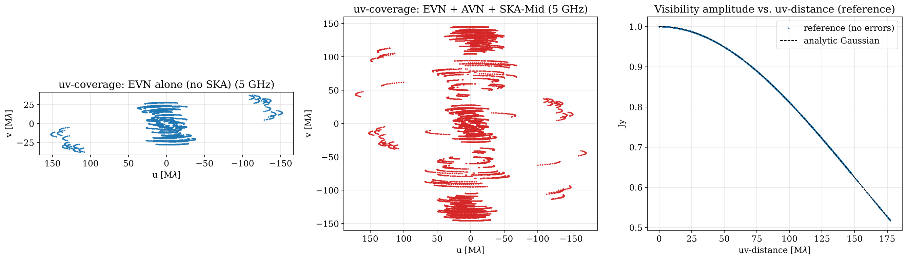
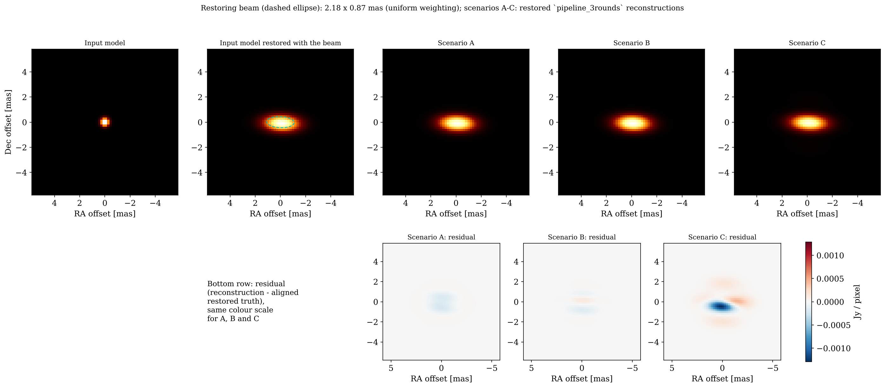
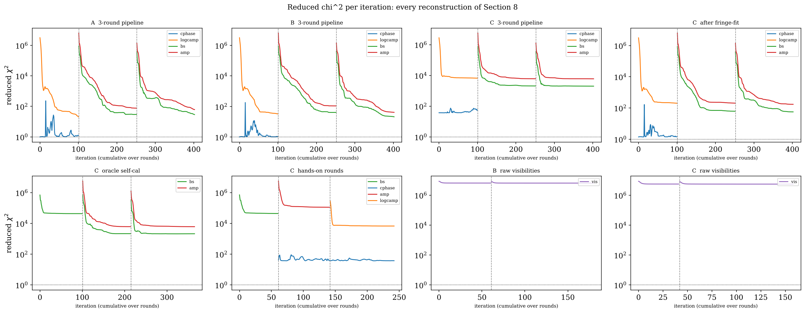
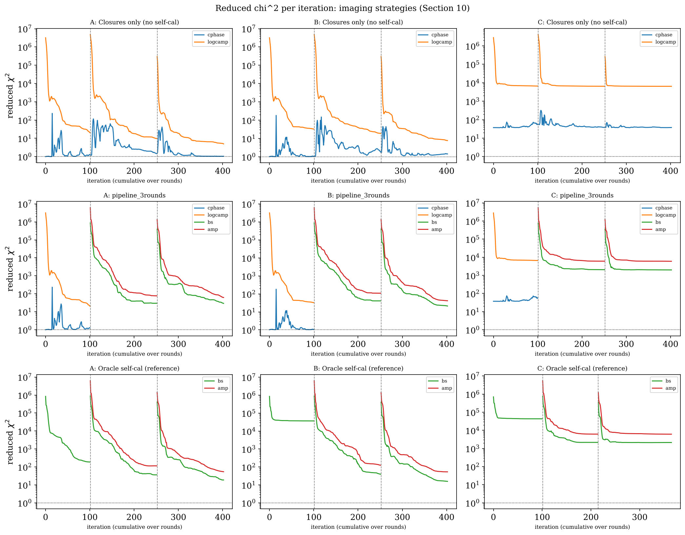
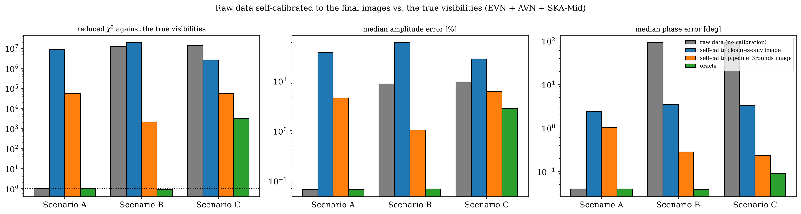
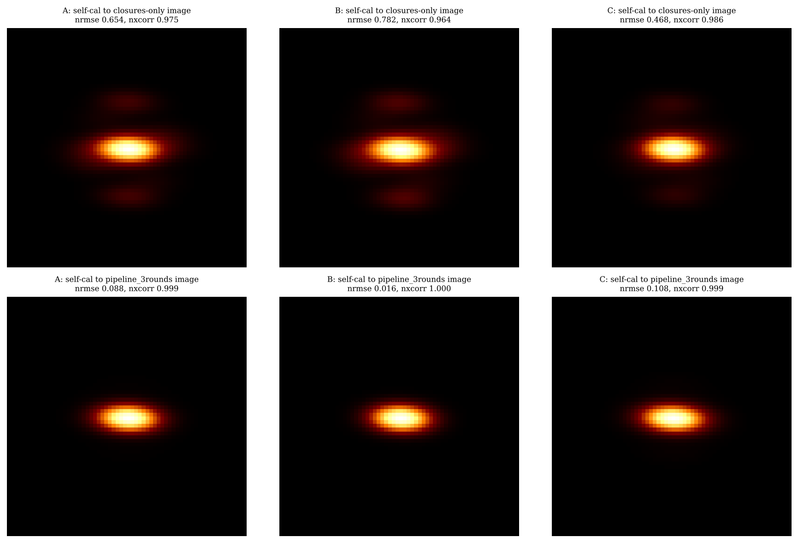
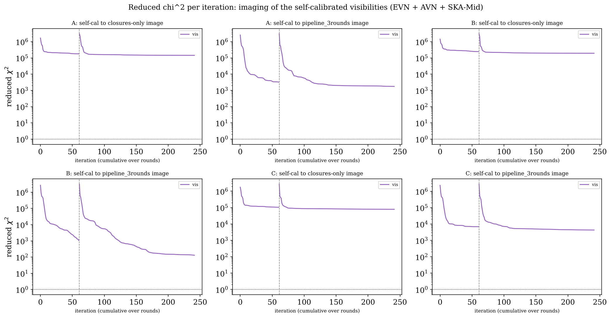

# EVN + AVN + SKA-Mid at 5 GHz: compact Gaussian source

**Case folder:** `point-source-midfreq/` · **Notebook:** `notebook/VLBI_ehtim_EVN_AVN_SKAMid_5GHz_Gaussian_ABC.ipynb` · **Toy model:** `toy-model/` (built by the notebook; FITS and text copies) · **Reference results:** `results/` · **Run time:** ~30 min

!!! important "Array: EVN + AVN + SKA-Mid (20 stations), SKA-Mid included in every simulation"
    11 EVN stations, **4 SKA-Mid elements** (`S5`, the phased-up SKA-Mid core, and the dishes `S004`, `S008`, `S133`) and 5 AVN stations. The **EVN alone (no SKA)** is simulated once, only for the uv-coverage comparison of Section 3. See [Arrays](../concepts/arrays.md).

This notebook runs the A/B/C test of the project on the simplest possible source at 5 GHz: a **compact, centred circular Gaussian** (0.5 mas FWHM, 1 Jy, RA 12 h, Dec +4°), the kind of source used as a VLBI calibrator. Because its visibility is known analytically and its closure phases are exactly zero, any departure from the ideal curves is an error, not structure. It has the same structure as the [jet notebook](../jet-midfreq/index.md) and as the [LBA + SKA-Low notebook](../point-source-lowfreq/index.md), with which it shares the scenarios, the pipeline and the screen of scenario C.

## Quick start

Run all cells; no external file is needed. A new run writes `notebook/results_VLBI_5GHz_Gaussian/` and its zip file; the reference run is in the case's `results/` folder.

---

## 0. Setup

Imports and helpers (`save_fig`, `mas`, `silent`). `ehtim` 1.2.10 needs **NumPy < 2** (restart the Colab session once after the install).

## 1. Array, sensitivities (SEFD) and observing parameters

Writes and loads the **EVN + AVN + SKA-Mid** array (`data/evn_avn_array.txt`, used everywhere) and the **EVN alone (no SKA)** (`data/evn_array.txt`, only for the uv-coverage figure); prints every station with its network (EVN, **SKA-Mid**, AVN) and SEFD; writes `tables/sefd_5GHz.csv`.

| Parameter | Default | Meaning |
|---|---|---|
| `nu`, `bw`, `n_chan` | 5 GHz, 256 MHz, 32 | frequency, bandwidth, channels for the in-band decorrelation of C |
| `tint`, `tadv` | 120 s, 600 s | 2-min scans every 10 min |
| `obs_hours` | 6 | length of the observing window (chosen in Section 3) |
| `elevation_min` | 10° | minimum elevation |
| `gain_offset_val`, `gainp_val` | 0.15, 0.10 | gain-error budget of B and C |
| `beam_weighting` | `'uniform'` | weighting of the restoring beam |

## 2. Gaussian source model

| Parameter | Default | Meaning |
|---|---|---|
| `flux_jy` | 1.0 | flux density [Jy] |
| `src_fwhm_mas` | 0.5 | FWHM [mas], about half the array beam |
| `src_ra_h`, `src_dec_deg` | 12 h, +4° | position (as in the 5 GHz hands-on) |
| `npix_model`, `fov_model` | 64, 10 mas | model grid |

The visibility of the Gaussian is

$$V(\rho) = S\,\exp\!\left[-\frac{(\pi\theta\rho)^2}{4\ln 2}\right],$$

which falls to ~0.8 S at 100 Mλ and ~0.5 S at 180 Mλ, the longest baselines of the array. The model pixels are delta functions (`deltaPulse2D`), so the simulated amplitudes follow this curve exactly; the notebook overplots it in Section 3.

**Output:** `01_input_model.png`.

## 3. Reference observation (no errors) and uv-coverage

Chooses the best 6-h window, simulates the error-free reference with the exact DFT (`ttype='direct'`), and compares the uv-coverage of the **EVN alone (no SKA)** with that of the **EVN + AVN + SKA-Mid**, together with the reference amplitudes and the analytic curve. A second cell counts baselines with median SNR > 5 and closure triangles with all legs above it.

**Output:** `02_uvcoverage_and_reference_amplitudes.png`.

## 4–6. Scenarios A, B and C

* **A** (`obs_A`): thermal noise only.
* **B** (`obs_B`): gains + random phases.
* **C** (`obs_C`): gains + the dTEC/delay screen of the LBA notebook (`dtec0_sigma` = 0.3 TECU, `dtec_rate` = 0.02 TECU/√min, `tau0_sigma_ns` = 0.5 ns, `tau_rate_ns` = 0.01 ns/√min), averaged over 32 channels and the scan. Also builds `obs_Cff` (idealised fringe fit) and the decorrelation of the delay-only and dTEC-only screens.

See [Scenarios](../concepts/scenarios.md). For a compact, bright source the SNR is high on every baseline, so the residual decorrelation of C stands out more clearly against the thermal noise than for the jet.

**Output:** `03_diagnostics_screen_and_visibilities.png`.

## 7. Self-calibration (oracle reference) and closure check

Oracle self-calibration of B and C (a best-case reference), closure-phase residuals against the reference (which are zero for a centred Gaussian), the check that a pure phase screen leaves closure phases unchanged, and the reduced χ² of the oracle-calibrated data.

**Output:** `04_closure_phase_residuals_and_decorrelation.png`.

## 8. Imaging: closure quantities vs. raw visibilities

The [3-round pipeline](../concepts/imaging.md#pipeline_3rounds-closures-first-then-self-calibration) on A, B, C and C after fringe fit, plus the references (oracle pipeline on C, hands-on rounds, raw visibilities of B and C): **8 reconstructions, each with its χ² history**.

| Parameter | Default | Why |
|---|---|---|
| `npix_rec`, `fov_beams` | 64, 10 | 64 pixels over 10 nominal beams (~10 mas), ~6 pixels per beam |
| `prior_fwhm` | one nominal beam | source-agnostic; a much larger prior can keep a closure-only round from converging |
| `w_simple`, `w_tv` | 100, 10 | the weights of the LBA notebook |
| `w_flux` | 1e5 | at these SNRs a weight of 1000 lets the total flux drift in closure-only rounds |
| `maxit_rounds` | (100, 150, 150) | iterations of the three rounds |
| `selfcal_round2` | `'both'` | amplitude + phase (the compact source does not need the phase-only first step of the jet) |

## 9. Metrics and diagnostics

Metrics table (compact flux / true, peak offset, dynamic range, total flux, `nrmse`, `nxcorr`), images (`05_reconstructions_all.png`, `06_scenarios_A_B_C_vs_truth.png`), the pipeline convergence for A, B, C (`07_chi2_convergence.png`) and **the χ² history of every reconstruction** (`07b_chi2_convergence_all_reconstructions.png`).

## 10. Comparison of imaging strategies

Closures only vs. `pipeline_3rounds` vs. oracle, on A, B and C: table, `08_imaging_strategies_comparison.png`, `09_fidelity_summary.png` and **the χ² history of every strategy and scenario** (`09b_chi2_convergence_imaging_strategies.png`).

## 11. Self-calibration to the final images: how well do the closures work?

**The added case.** For each scenario the **raw** data are self-calibrated (amplitude + phase, one gain per station and scan) to two models: the **closures-only image** of Section 10 (a direct test of the closure quantities) and the **final image of `pipeline_3rounds`** (the last image generated). Each model is first moved, sub-pixel, to the true position (closures do not fix the absolute position, and a shift is an antenna-based phase gradient). The calibrated visibilities are then compared with the **noise-free visibilities of the true source**, and imaged once more with the raw-visibility recipe (`vis_rounds`), recording the χ² at every iteration. See [Self-calibration test](../concepts/imaging.md#selfcal-test).

| Output | Content |
|---|---|
| table (printed and `selfcal_to_final_images_visibility_errors.csv`) | per scenario: raw data, self-cal to the closures-only image, self-cal to the pipeline image, oracle; model shift, **reduced χ² against the true visibilities**, median amplitude error [%], median phase error [deg] (SNR > 5) |
| `10_selfcal_to_final_images_visibility_errors.png` | the three error measures as bar charts, per scenario |
| `10b_images_of_selfcalibrated_visibilities.png` | the 6 images made from the self-calibrated visibilities, with NRMSE and NXCORR |
| `10c_chi2_convergence_selfcalibrated_visibilities.png` | **χ² at every iteration** of those 6 reconstructions |
| `visibilities/scenario{A,B,C}_selfcal_to_{closures,pipeline}_image.uvfits` | the calibrated visibilities |

**How to read it.** If the χ² against the truth and the phase/amplitude errors after self-calibration to the closures-only image are close to those of the oracle, the closure quantities alone captured the source well enough to calibrate the data. The gap between the two models shows what the later rounds of the pipeline add. In scenario C, no antenna-based calibration (not even the oracle) can remove the in-band decorrelation, so the oracle χ² is itself above 1.

## 12. Discussion of the results

Discussion of the numbers of the run (see [below](#results-of-the-reference-run)).

## 13. Export

`results_VLBI_5GHz_Gaussian/` and its zip file: `visibilities/` (reference, A, B, C, C after fringe fit, oracle-calibrated B and C, and A, B, C self-calibrated to the closures-only and pipeline images), `figures/`, `images/` and `tables/` (`metrics_*.csv`, `chi2_final_per_round.csv`, `selfcal_to_final_images_*.csv`, `pipelines_regularizers.*`, `sefd_5GHz.csv`, `screen_scenarioC.npz`, `array_EVN_AVN_SKAMid.txt`, `array_EVN_alone_noSKA.txt`, `README.txt`).

## 14. Conclusions and limitations

What the test measures and its assumptions.

---

## Results of the reference run

Reference run: one CPU core, **~30 min**. Array: **EVN + AVN + SKA-Mid** (20 stations). The numbers of B and C change slightly from run to run ([why](../getting-started.md#reproducibility)).

**Data.** 6314 visibilities on all 190 baselines (the **EVN alone (no SKA)** would give 1742); all 1140 closure triangles with SNR > 5; median SNR ~830. Longest baseline 178 Mλ (1.16 mas); restoring beam 2.18 × 0.87 mas, PA 88°. Scenario C: mean |Γ| = 0.92 (delay term only: 0.92; dTEC term only: 0.9995; after an idealised fringe fit: 0.989).

<figure markdown>

<figcaption>uv-coverage of the EVN alone (no SKA) and of the EVN + AVN + SKA-Mid, and the reference amplitudes against the analytic Gaussian curve.</figcaption>
</figure>

| Reconstruction | nrmse | flux [Jy] | dynamic range |
|---|---|---|---|
| A, `pipeline_3rounds` | 0.02 | 0.99 | ~1570 |
| B, `pipeline_3rounds` | 0.01 | 1.00 | ~1930 |
| C, `pipeline_3rounds` | 0.09 | 1.01 | ~730 |
| C after idealised fringe fit | 0.02 | 1.00 | ~1730 |
| C, oracle pipeline | 0.01 | 1.00 | ~2070 |
| B / C raw visibilities | 8.9 / 10.1 | 0.15 / 0.14 | 33 / 29 |

| Strategy (Section 10), nrmse | A | B | C |
|---|---|---|---|
| Closures only | 0.12 | 0.13 | 0.14 |
| `pipeline_3rounds` | **0.02** | **0.01** | **0.09** |
| Oracle self-cal | 0.01 | 0.02 | 0.01 |

<figure markdown>

<figcaption>Scenarios A, B and C with the pipeline, the restored truth and the residuals.</figcaption>
</figure>

<figure markdown>

<figcaption>Reduced χ² of every data term at every iteration, for every reconstruction of Section 8. In C every term flattens at ~10³–10⁴ from the first iterations (non-antenna-based decorrelation); after the idealised fringe fit it behaves like B.</figcaption>
</figure>

<figure markdown>

<figcaption>χ² per iteration of the three imaging strategies. The closures-only runs end with logcamp χ² ≈ 5–8 in A and B.</figcaption>
</figure>

**Self-calibration to the final images (Section 11).**

| Scenario | Visibilities | χ² vs. true | Amplitude error | Phase error |
|---|---|---|---|---|
| B | raw | 1×10⁷ | 8.8 % | 91° |
| B | self-cal to closures-only image | 2×10⁷ | 59 % | 3.5° |
| B | self-cal to pipeline image | 2100 | **1.0 %** | **0.28°** |
| B | oracle | 0.91 | 0.07 % | 0.04° |
| C | self-cal to closures-only image | 3×10⁶ | 28 % | 3.3° |
| C | self-cal to pipeline image | 6×10⁴ | 6.1 % | 0.23° |
| C | oracle | 3200 | 2.8 % | 0.09° |

<figure markdown>

<figcaption>Raw data self-calibrated to the closures-only image (blue) and to the pipeline image (orange), compared with the true visibilities.</figcaption>
</figure>

<figure markdown>

<figcaption>Images of the self-calibrated visibilities. Top: self-calibrated to the closures-only image (too broad, with sidelobes). Bottom: self-calibrated to the pipeline image.</figcaption>
</figure>

<figure markdown>

<figcaption>χ² per iteration of the imaging of the self-calibrated visibilities.</figcaption>
</figure>

**Main conclusions.**

* Closures plus iterative self-calibration remove antenna-based errors completely: **B is as good as A**.
* For a source **smaller than the beam**, the closure quantities alone recover the **phases** (2–3.5° after self-calibration to the closures-only image) but **not the amplitudes**: amplitude self-calibration to that image introduces 28–59% errors. Use a closure image first for a **phase-only** self-calibration.
* The pipeline image is a good self-calibration model (1% / 0.3° in B; re-imaging gives nrmse 0.016).
* Scenario C at 5 GHz is limited by the **delay** part of the screen, which a fringe fit removes.

## Troubleshooting

| Symptom | Cause and fix |
|---|---|
| `numpy.core.multiarray failed to import` | NumPy ≥ 2: `pip install "numpy<2"`, restart the kernel. |
| The kernel dies in Section 3 or 7 | Out of memory; do not call `obs.add_all()` with 20 stations. |
| Reconstruction much larger than 0.5 mas | Normal: compare with the restored truth (true model blurred with the fitted dirty beam), not with the input model. |
| Numbers of B and C differ from the guide | `ehtim` gain seeds depend on the Python hash seed; use `PYTHONHASHSEED=0`. |
