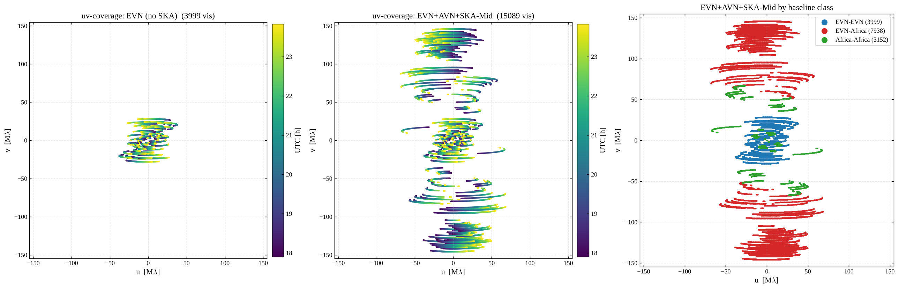
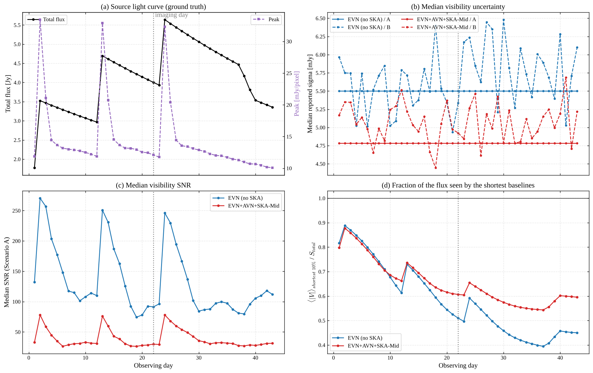
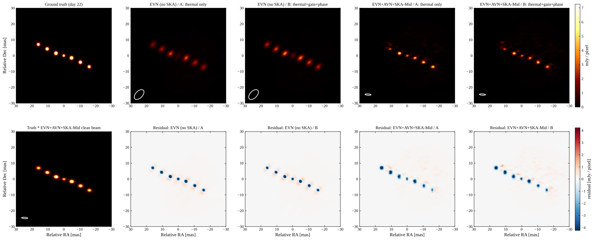
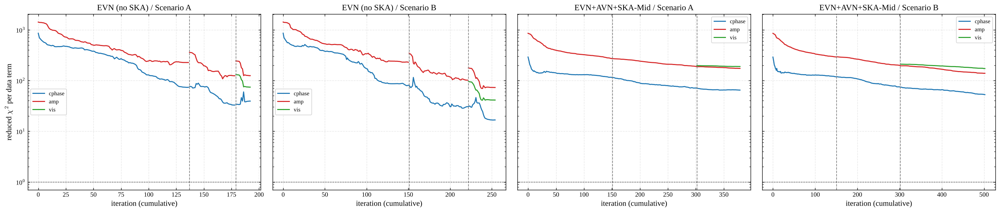
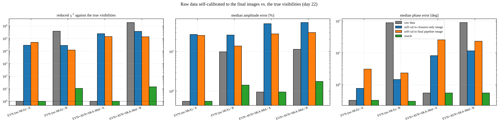
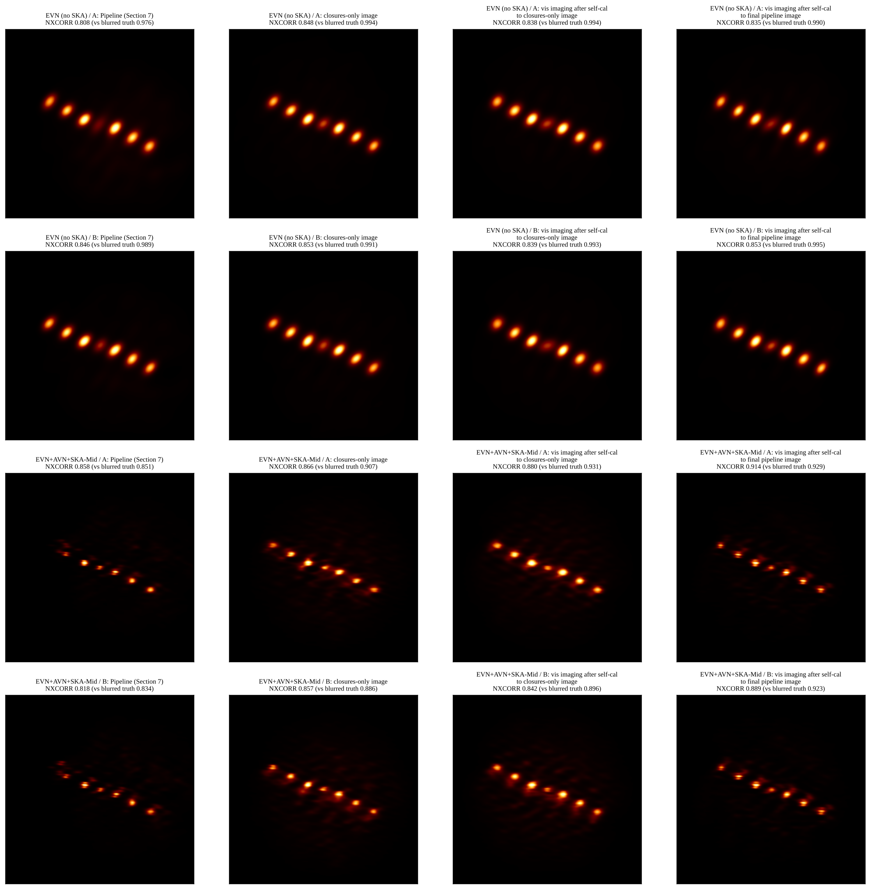
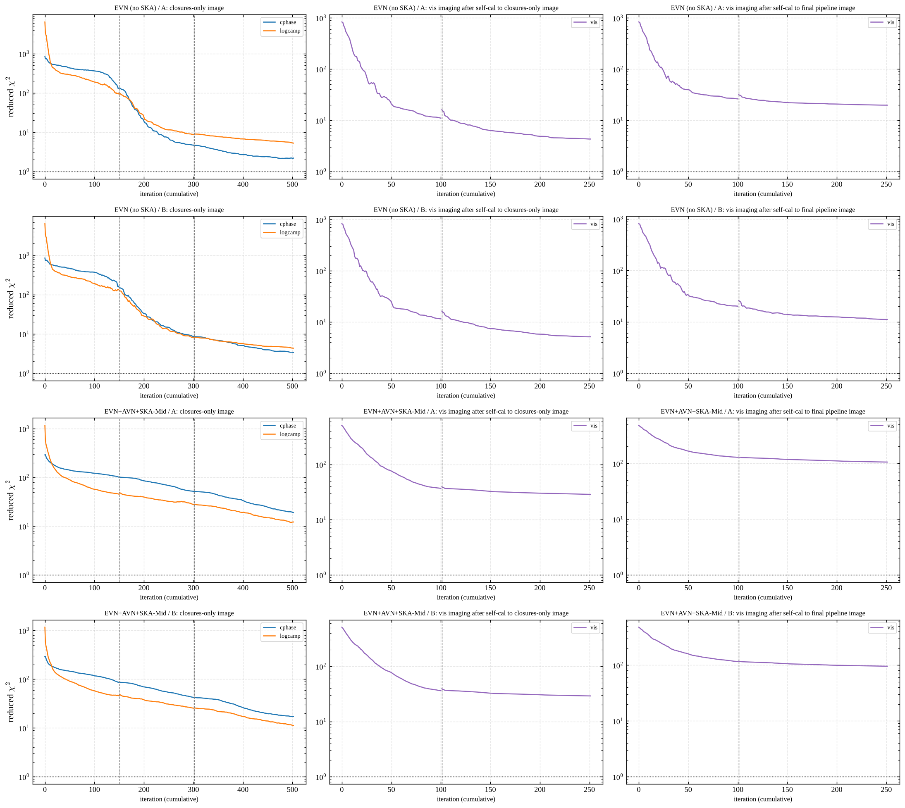

# X-ray binary jet campaign: EVN (no SKA) vs. EVN + AVN + SKA-Mid

**Case folder:** `xray-binary-jet-midfreq/` · **Notebook:** `notebook/binary_jet_VLBI_ehtim_campaign.ipynb` (single-frame quick look, ~1 h 30 min with the self-calibration test) · **Scripts:** `script/toy_model_xray_binary_jet.py` (toy model only, < 1 min) and `script/binary_jet_VLBI_campaign_full.py` (full campaign, days) · **Toy model:** generated by code (`toy-model/` has a snapshot and its parameters) · **Reference results:** `results/` (notebook run)

!!! important "Arrays: EVN (no SKA) and EVN + AVN + SKA-Mid"
    The dynamic case compares two arrays at 5 GHz:

    * **EVN (no SKA)**: 10 EVN stations;
    * **EVN + AVN + SKA-Mid**: the same 10 EVN stations + **4 SKA-Mid elements** (`S5`, the phased-up SKA-Mid core, SEFD 3.1 Jy; `S004`, `S008`, `S133`) + 5 AVN stations (HH, KU, NA, BW, ML), 19 stations.

    **SKA-Mid is part of every simulation, image and metric labelled "EVN+AVN+SKA-Mid"**, so the difference between the two arrays is the combined effect of the AVN and SKA-Mid. In the baseline-class plots, *Africa* = AVN + SKA-Mid. In the script's CSV files and folders the arrays keep the short tags `EVN` and `EVN+AVN` / `EVN_AVN` (for compatibility with runs in progress); `EVN+AVN` always includes SKA-Mid.

This case simulates a **43-day monitoring campaign of the precessing, double-sided jet of an X-ray binary** (a toy model inspired by the microquasar SS 433, where a compact object accretes from a companion star and launches two opposite jets whose axis precesses): blobs are ejected in pairs along a helix, move outwards and fade. The source changes *during* each 6-h track, so the visibilities come from an `ehtim` movie (`Movie.observe_same`). Only scenarios **A and B** are used; [Scenarios](../concepts/scenarios.md#scenario-c-in-the-binary-jet-case) explains why C is left out.

| File | What it does | Run time |
|---|---|---|
| Notebook | simulates the **whole campaign** in the data domain (every day, both arrays, both scenarios), **images one frame** (`IMAGING_DAY`) and tests the closures by self-calibrating to the final images | ~1 h 30 min |
| Toy-model script | writes only the **toy model**: the true sky of every day (FITS, PNG), a GIF, a montage and the light curve | < 1 min |
| Campaign script | images **every day**, for A and B and for three variability rates (1×, 5×, 20×); per-day metrics, GIFs, UVFITS, global plots | ~3–4 days per scenario |

---

## The notebook

### 0. Environment setup and global configuration

`ehtim` 1.2.10 (NumPy < 2). The configuration cell (0.1) holds every parameter:

| Parameter | Default | Meaning |
|---|---|---|
| `N_DAYS` | 43 | observing days (set 8 for a quick test) |
| `IMAGING_DAY` | `N_DAYS // 2 + 1` (22) | the single day that is imaged |
| `FRAMES_PER_DAY` | 4.76 | model frames advanced per observing day |
| `TIME_FACTOR` | 1.0 | time compression of the source evolution within a track |
| `RF_HZ`, `BW_HZ` | 5 GHz, 128 MHz | frequency and bandwidth |
| `TINT_S`, `TADV_S` | 12 s, 240 s | integration time and scan spacing |
| `ELEVMIN`, `WINDOW_HOURS` | 10°, 6 h | elevation limit; track centred on transit |
| `FPS_SIM` | 4 | movie frames per hour within a track |
| `RA_SOURCE`, `DEC_SOURCE` | 19.19 h, +4.98° | source position |
| `OBSERVATION_FOV`, `NPIX` | 60 mas, 256 | image field of view and grid |
| `N_BLOBS`, `SPACING_FRAMES`, `PRECESSION_PERIOD`, `OPENING_ANGLE` | 20, 52, 800, 0.55 | jet model |
| `SCENARIOS` | A, B | `gain_offset` 0.15, `gainp` 0.10, `phasecal=False` in B |
| `TTYPE` | `'fast'` | Fourier engine (`'nfft'` needs `pynfft`) |
| `SAVE_UVFITS` | `'imaging_day'` | `'all'`, `'imaging_day'` or `'none'` |

### 1. Array configuration: EVN (no SKA) vs. EVN + AVN + SKA-Mid

Writes `data/EVN_noSKA_array.txt` and `data/EVN_AVN_SKAMid_array.txt` and prints the composition of each array (10 EVN; 10 EVN + 4 **SKA-Mid** + 5 AVN). Section 1.1 maps the stations and their SEFDs (`01_array_map_sefd.png`).

### 2. Sky model: a time-variable precessing jet

A vectorised renderer (`gaussian_array()`, numerically checked against `Image.add_gauss`, ~1000× faster) of a core plus up to 20 ejecta pairs. Section 2.2 shows the truth on 8 days of the campaign (`02_ground_truth_montage.png`).

### 3. Observing engine

For each day: a template observation of the central frame fixes the schedule; the movie (~25 frames over the track) is then observed with `Movie.observe_same()` with the errors of the scenario. The 6-h window is centred on the source transit.

### 4. Campaign simulation

One movie per day, observed with {**EVN (no SKA)**, **EVN + AVN + SKA-Mid**} × {A, B}. The noise-free observation of the imaging day (`IDEAL`) is kept as the exact error-free reference. UVFITS files are written according to `SAVE_UVFITS`.

### 5. uv-plane and data statistics (imaging day)

No imaging needed: the kind of analysis that justifies an array in a proposal.

* **5.1** uv-coverage of both arrays by UTC time, and of the EVN + AVN + SKA-Mid by baseline class: EVN–EVN, EVN–Africa (long north–south baselines) and Africa–Africa (short spacings, including the SKA-Mid ones) (`03_uv_coverage.png`).
* **5.2** Station availability over the track and baseline-length distribution (`04_station_availability_baselines.png`).
* **5.3** Quantitative summary of the arrays (visibilities, baselines, beam, SNR), and statistics per baseline class.
* **5.4** Dirty beams (`05_dirty_beams.png`), normalised to 1 at the centre.
* **5.5** Visibilities: ideal vs. A vs. B (`06_visibility_amp_phase.png`).
* **5.6** Corruption statistics and the invariance of closure quantities (`07_corruption_statistics.png`).

### 6. Campaign-wide statistics (all days)

* **6.1** Light curve, visibility uncertainty, SNR and short-baseline amplitude over the 43 days (`08_campaign_evolution.png`).
* **6.2** Visibility-amplitude "waterfall" (day × |uv|) for both arrays (`09_visibility_waterfall.png`).
* **6.3** Campaign summary table (`campaign_summary.csv`).

### 7. Imaging of a single frame

Three RML rounds, the same recipe as the script:

| Round | Data terms | Regularizers | Iterations |
|---|---|---|---|
| 1 | `cphase`, `amp` | `simple`, `flux`, `cm` | 150 |
| 2 | `cphase`, `amp` | `tv`, `l1`, `flux`, `cm` | 150 |
| 3 (after phase self-cal) | `cphase`, `amp`, `vis` | `tv`, `l1`, `flux`, `cm` | 200 |

| Parameter | Default | Why |
|---|---|---|
| `SYS_NOISE` | 0.02 | 2% systematic error in quadrature, for imaging only: the SKA-Mid core baselines reach SNR ~8,600, and a static image cannot fit a source that changes during the track to that precision |
| `PRIOR_PERTURB` | 0.10 | random 10% perturbation of the Gaussian prior: the jet and the prior are point-symmetric, and symmetric data on a symmetric start can stall the optimiser |
| `PRIOR_FWHM_FRAC` | 0.4 | prior FWHM as a fraction of the FOV |
| `RESTORE_BLUR` | 0.4 | final restoring blur, as a fraction of the clean beam |

Round 1 is repeated with a new perturbation if it stalls. Each reconstruction records **the χ² of every data term at every iteration**. Figures: dirty vs. restored images (`10_dirty_vs_restored.png`), truth vs. reconstructions and residuals (`11_truth_vs_reconstructions.png`), integrated profile along the jet (`12_integrated_profile.png`).

### 8. Metrics and summary

* **8.1** RMSE, NRMSE, NXCORR, NXCORR against the truth at the same resolution, SSIM, dynamic range, flux ratio, χ²(cphase), χ²(amp) (`13_metrics_summary.png`, `imaging_metrics_day22.csv`).
* **8.2** **Convergence of the data fit**: the χ² of every data term at every iteration for **all four reconstructions** (both arrays × both scenarios), `14_chi2_convergence.png`, and the final χ² per round.
* **8.3** An automatic reading of the numbers: resolution gain from adding the AVN + SKA-Mid, visibilities, NXCORR per array and scenario, closure-phase errors.

### 8.4 Self-calibration to the final images: how well do the closures work?

The added case, for the four datasets: a **closures-only image** (`cphase` + `logcamp`, the regularizers and iterations of the pipeline), then a self-calibration of the **raw** data (amplitude + phase, per time stamp) to it and to the **final pipeline image** of Section 7, both moved sub-pixel to the true position. The calibrated visibilities are compared with the **noise-free visibilities of the true, time-variable source** (`IDEAL`), next to the raw data and an oracle self-calibration to the true central frame; each calibrated dataset is then imaged from the prior with the complex visibilities, with the χ² recorded at every iteration.

| Output | Content |
|---|---|
| `selfcal_to_final_images_visibility_errors_day22.csv` | model shift, **reduced χ² against the true visibilities**, median amplitude and phase errors (SNR > 5), per dataset and calibration |
| `selfcal_to_final_images_reconstructions_day22.csv` | NRMSE, NXCORR, NXCORR vs. blurred truth and flux ratio of the closures-only images and of the images of the self-calibrated visibilities |
| `15_selfcal_to_final_images_visibility_errors.png` | the error measures as bar charts |
| `16_images_closures_only_and_selfcalibrated_visibilities.png` | pipeline image, closures-only image and the two images of self-calibrated visibilities, per dataset |
| `17_chi2_convergence_closures_only_and_selfcalibrated_visibilities.png` | **χ² at every iteration** of the 12 reconstructions of this section |
| `uvfits/<array>_<scenario>/obs_day_22_selfcal_to_*.uvfits` | the calibrated visibilities |

Because the source changes during the track, no static model (not even the true central frame) can bring the χ² against the true visibilities to 1; compare each calibration with the oracle rather than with 1. This section takes ~50 min; set `RUN_SELFCAL_TEST = False` to skip it.

### 9. Discussion of the results

Discussion of the run (see [below](#results-of-the-reference-run)).

### 10. Export

`binary_jet_results/` and `binary_jet_results.zip`: `uvfits/` per array and scenario (`EVN_noSKA_A`, `EVN_AVN_SKAMid_B`, …, plus `IDEAL_noisefree`), `images/`, `figures/`, `tables/` (campaign summary, corruption statistics, imaging metrics, final χ² per round, array summary, `config.json`, `array_EVN_noSKA.txt`, `array_EVN_AVN_SKAMid.txt`), `README.txt`.

### 11. Conclusions, limitations and references

---

## The toy-model script

`toy_model_xray_binary_jet.py` builds **only the sky model** of the X-ray binary jet, with the same functions and parameters as the notebook and the campaign script (its day-22 frame is identical, pixel by pixel, to the truth used for imaging). Use it to look at the source, to feed the model to other software, or to try other model parameters (they have the same names in the campaign script, where they must be changed too).

```bash
python script/toy_model_xray_binary_jet.py                              # 43 days, default parameters
python script/toy_model_xray_binary_jet.py --track-day 22 --factor 20   # also the evolution within the track of day 22
```

| Option | Default | Meaning |
|---|---|---|
| `--days` | 43 | observing days |
| `--out` | `xray_binary_toy_model` | output folder |
| `--npix`, `--fov` | 256, 60000 µas | image grid |
| `--track-day` | none | also write the frames of the source during the 6-h track of that day |
| `--factor` | 1 | variability rate within the track (1×, 5×, 20× as in the campaign) |
| `--fps` | 4 | frames per second of the GIFs |

Outputs: `fits/day_XX.fits` and `png/day_XX.png` (every day), `toy_model_campaign.gif`, `montage.png`, `light_curve.csv` / `.png` (1.8–5.6 Jy over the campaign), `parameters.json`, and `track_day_XX_factor_F/` with `--track-day`. The parameters of the model are listed in `toy-model/README.md`.

## The full-campaign script

`binary_jet_VLBI_campaign_full.py` uses the same sky model, arrays, observing set-up, scenarios and imaging recipe as the notebook, but images **every day**. Each day starts from the previous day's reconstruction (blurred and rescaled to the true flux), so a run must be sequential in days; the scenarios and variability factors are independent and can run in parallel.

### Usage

```bash
pip install "numpy<2" ehtim==1.2.10 matplotlib pandas imageio scikit-image   # scikit-image: optional (SSIM)

# everything (A and B, three variability factors, 43 days)
python script/binary_jet_VLBI_campaign_full.py

# recommended on a multi-core VM: A and B as two parallel background processes
nohup python script/binary_jet_VLBI_campaign_full.py --scenarios A > run_A.log 2>&1 &
nohup python script/binary_jet_VLBI_campaign_full.py --scenarios B > run_B.log 2>&1 &
# ... when both have finished, merge everything into the global plots and tables
python script/binary_jet_VLBI_campaign_full.py --summary-only

# quick test (~20 min)
python script/binary_jet_VLBI_campaign_full.py --days 2 --factors realistic --ttype fast
```

| Option | Default | Meaning |
|---|---|---|
| `--scenarios` | `A B` | error scenarios to run |
| `--factors` | `realistic exaggerated extreme` | variability rates within a track: 1×, 5×, 20× |
| `--days` | 43 | observing days |
| `--ttype` | `auto` | `nfft` if `pynfft` is installed, otherwise `fast` |
| `--out` | `binary_jet_campaign_results` | output folder, shared by parallel runs |
| `--overwrite` | off | restart the selected runs from day 1 |
| `--save-txt` | off | also write `ehtim` `.txt` files |
| `--summary-only` | off | rebuild only the global plots and tables from the CSV files |
| `--maxit R1 R2 R3` | `150 150 200` | iterations per round (`50 50 80` restores the speed of the first version) |
| `--sys-noise` | 0.02 | systematic error budget for imaging |

**Resuming.** Metrics are appended to a CSV file after every day. If a run is interrupted, start it again with the same options: it resumes from the last completed day.

### Outputs

Per factor and scenario: per-day metrics CSV, frames (truth | **EVN (no SKA)** | **EVN + AVN + SKA-Mid**), single-array frames and animated GIFs, FITS images, UVFITS files, and PDF maps (dirty image and beam, clean beam, restored image) for the middle day. After `--summary-only`: global plots of χ²(cphase), χ²(amp), RMSE, NXCORR, NXCORR vs. blurred truth, dynamic range and flux ratio per day, a Pareto scatter, a combined triple plot and a summary table.

---

## Results of the reference run

Reference run of the notebook: one CPU core, **~1 h 30 min** (Section 4: 15 min; Section 7: 18 min; Section 8.4: 49 min). Imaging day 22, true total flux 4.0 Jy. The single-frame numbers change by up to ~0.1 in NXCORR between runs ([why](../getting-started.md#reproducibility)).

| | EVN (no SKA) | EVN + AVN + SKA-Mid |
|---|---|---|
| Stations / baselines | 10 / 45 | 19 / 171 |
| Visibilities per day | 3,999 | 15,089 |
| Longest baseline | 43 Mλ | 147 Mλ |
| Fitted beam | 7.6 × 4.3 mas, PA 136° | 3.9 × 0.9 mas, PA 86° |
| Median SNR (imaging day, A) | 91 | 30 (EVN–EVN 91, EVN–Africa 8, Africa–Africa 154) |
| Median SNR per day (campaign) | 134 ± 56 | 39 ± 15 |
| Closure-phase scatter A / B | 1.2° / 1.2° | 4.9° / 4.7° |

<figure markdown>

<figcaption>uv-coverage of the EVN (no SKA) and of the EVN + AVN + SKA-Mid on the imaging day; right: baseline classes (Africa = AVN + SKA-Mid).</figcaption>
</figure>

<figure markdown>

<figcaption>The 43-day campaign in the data domain: light curve (1.8–5.6 Jy), visibility uncertainty, SNR and short-baseline amplitude per day.</figcaption>
</figure>

**Imaging of day 22.**

| Dataset | NXCORR | NXCORR vs. truth at the same resolution | dynamic range | flux ratio |
|---|---|---|---|---|
| EVN (no SKA) / A | 0.81 | 0.98 | ~110 | 1.11 |
| EVN (no SKA) / B | 0.85 | 0.99 | ~170 | 1.14 |
| EVN + AVN + SKA-Mid / A | 0.86 | 0.85 | ~140 | 1.03 |
| EVN + AVN + SKA-Mid / B | 0.82 | 0.83 | ~110 | 1.04 |

<figure markdown>

<figcaption>Ground truth and the four restored reconstructions (top), and residuals (bottom).</figcaption>
</figure>

<figure markdown>

<figcaption>Reduced χ² of every data term at every iteration, for the four reconstructions. All rounds converged without retries; the χ² stays at ~20–190 (a static image of a source that changes during the track).</figcaption>
</figure>

**Self-calibration to the final images (Section 8.4).**

| | Phase error (EVN / EVN+AVN+SKA-Mid) | Amplitude error | χ² vs. true visibilities |
|---|---|---|---|
| raw data, B | 89° / 89° | 10% / 11% | 4 × 10⁵ / 2 × 10⁶ |
| self-cal to the closures-only image | **0.8–1.4° / 8–12°** | 26% / 50–53% | 3 × 10⁴ / 2–4 × 10⁵ |
| self-cal to the final pipeline image | 2.3–3.1° / 23–26° | 14–25% / 28–30% | 1–5 × 10⁴ / 1.4 × 10⁵ |
| oracle (true central frame), B | 0.3° / 0.5° | 1.4% / 1.8% | 11 / 14 |

<figure markdown>

<figcaption>Raw data self-calibrated to the closures-only image and to the final pipeline image, compared with the noise-free visibilities of the time-variable source.</figcaption>
</figure>

<figure markdown>

<figcaption>Per dataset: pipeline image, closures-only image, and the images of the visibilities self-calibrated to each.</figcaption>
</figure>

<figure markdown>

<figcaption>χ² per iteration of the closures-only reconstructions and of the imaging of the self-calibrated visibilities.</figcaption>
</figure>

**Main conclusions.**

* Scenario B is recovered as well as A with both arrays: the closure phases of A and B are identical.
* The **EVN (no SKA)** images are very faithful at their coarse resolution (0.98–0.99); the **EVN + AVN + SKA-Mid** images resolve the components (beam 3.9 × 0.9 mas) but less faithfully (0.83–0.85), because the resolution comes from the low-SNR EVN–Africa baselines.
* The closures alone give the best **phase** model with both arrays; neither image is a good **amplitude** model. One more self-calibration and imaging step raises the EVN + AVN + SKA-Mid NXCORR from 0.82–0.86 to 0.89–0.91.
* The robust result is the 43-day statistics of the script; a single frame is an illustration.

## Troubleshooting

| Symptom | Cause and fix |
|---|---|
| `Warning: No NFFT installed!` | Harmless; the notebook uses `fast`. For the script, install `pynfft` to use `nfft`, or pass `--ttype fast`. |
| `scikit-image not installed: SSIM skipped` | Optional: `pip install scikit-image`. All other metrics are computed. |
| The EVN + AVN + SKA-Mid reconstruction stalls in round 1 | Handled by the prior perturbation and the stall guard; if it persists, raise `PRIOR_PERTURB` slightly. |
| χ² of the EVN + AVN + SKA-Mid data far above 1 | Expected at SNR of thousands for a source that changes during the track; `SYS_NOISE` sets how much of this is tolerated. |
| The script is too slow | Run A and B in parallel, select `--factors`, or reduce `--maxit`. |
